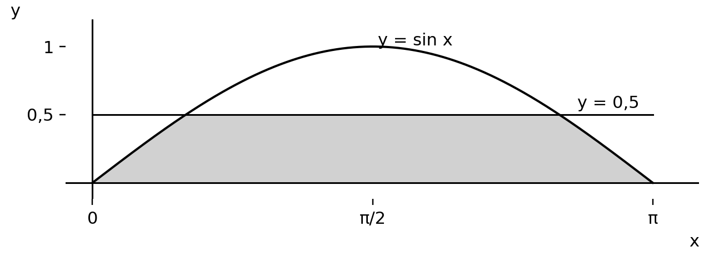
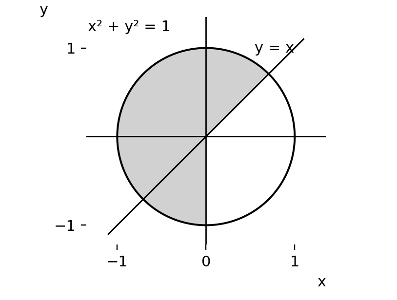

# Контрольная работа по информатике

| Параметр | Значение |
|---|---|
| Дисциплина | Информатика |
| Институт | ИРИП |
| Кафедра | Индустриального программирования |
| Вид учебного материала | Контрольная работа |
| Преподаватель | Александров Алексей Сергеевич |
| Семестр | 1 семестр |

## Вариант 1

Выполните 10 заданий. Звёздочкой отмечены задания повышенного уровня. В расчётных заданиях приведите ход решения; допускается научный калькулятор. В заданиях на Python 3 приведите код и результаты его выполнения. Вещественные числа в коде записывайте через точку. Логические значения в таблицах записывайте как 0 и 1.

### Теория информации

#### Задание 1. Энтропия источника | Расчёт

Источник формирует четыре сообщения с вероятностями 0,4; 0,3; 0,2; 0,1. Вычислите энтропию по Шеннону и максимальную энтропию для четырёх сообщений. Запишите формулы, подстановку и ответ в битах на сообщение с точностью до четырёх знаков после запятой. Объясните, почему значения различаются.

#### Задание 2*. Частоты и предсказуемость | Python

Для четырёх сообщений заданы два набора частот: A = [16, 8, 4, 4] и B = [8, 8, 8, 8]. Напишите программу, которая для каждого набора получает вероятности из частот, выводит их сумму и вычисляет энтропию Шеннона. Выведите разность H(B) − H(A). По результатам укажите, какой источник более предсказуем, и объясните ответ.

### Обнаружение и исправление ошибок

#### Задание 3. Контроль чётности | Python

Напишите программу для сообщения 1100101. Добавьте справа бит чётного контроля. В полученном кодовом слове измените второй бит слева и выполните проверку чётности. Затем снова возьмите исходное кодовое слово, измените второй и пятый биты слева и повторите проверку. Выведите исходное кодовое слово, оба искажённых слова и результаты проверок. Объясните различие результатов. Позиции считаются с единицы.

#### Задание 4*. Сравнение способов защиты | Расчёт

Для сообщения 1010 примените два способа защиты: добавление справа бита чётного контроля и троирование каждого бита.

а) Запишите оба кодовых слова, их длины и число дополнительных битов.

б) Определите, сколько различных слов можно получить из каждого кодового слова инверсией ровно одного бита. Сколько таких ошибок обнаружит контроль чётности и сколько исправит троирование?

в) В троированном слове измените первый и второй биты слева. Покажите декодирование по большинству и сравните результат с исходным сообщением. Объясните ограничение метода.

### Представление чисел и вычисления

#### Задание 5. Представление чисел со знаком | Расчёт

В восьмиразрядной сетке представьте число −43 в прямом, обратном и дополнительном кодах. Покажите переходы между кодами. Затем определите десятичное значение дополнительного кода 11010110 и покажите вычисления. Старший разряд является знаковым.

#### Задание 6*. Табулирование функции | Python

Напишите программу для вычисления функции:

f(x, y) = ∛sin(x · e^(0,1y)), если x + y ≤ 2;
f(x, y) = log₂(x + y), если x + y > 2.

x изменяется от 1 до 2,5 включительно с шагом 0,5, y — от 1 до 4 включительно с шагом 1. Используйте два вложенных цикла. Выведите x, y, номер выбранной ветви и f(x, y) с шестью знаками после запятой для всех пар аргументов. Кубический корень понимается как вещественный; углы задаются в радианах.

### Алгебра логики и побитовые операции

#### Задание 7. Таблица истинности | Python

Программно постройте полную таблицу истинности функции:

F(A, B) = (((A ∨ B) → A) ↔ B).

Переберите наборы в порядке 00, 01, 10, 11. Выведите столбцы A, B, A ∨ B, (A ∨ B) → A и F в виде нулей и единиц. Отдельно выведите наборы, на которых F = 1. Импликацию и эквивалентность реализуйте через операции Python.

#### Задание 8*. Обнуление младших битов | Расчёт

В восьмиразрядном беззнаковом представлении дано n = 235. Обнулите три младших бита: запишите исходное число, восьмибитовую маску и результат операции AND в двоичном и десятичном виде. Затем запишите общее выражение для обнуления k младших битов при 0 ≤ n ≤ 255 и 0 ≤ k ≤ 8, используя побитовые операции, сдвиги и при необходимости вычитание. Циклы не используйте. Укажите результаты для n = 235 при k = 0 и k = 8. Биты нумеруются справа с нуля.

### Нормальные формы и логические условия

#### Задание 9. Совершенные нормальные формы | Расчёт

Для функции

L(x, y, z) = (x ∨ ¬z) → (y ∧ z)

составьте таблицу истинности в порядке 000, 001, …, 111. Покажите промежуточные столбцы x ∨ ¬z и y ∧ z. По таблице запишите СДНФ и СКНФ, соблюдая порядок переменных x, y, z. Укажите число слагаемых СДНФ и число сомножителей СКНФ.

#### Задание 10*. Принадлежность области | Python

По рисунку составьте условие принадлежности точки заштрихованной области. Рассматривайте полуволну синуса при 0 ≤ x ≤ π. Все границы включаются в область, углы задаются в радианах.

Напишите программу, которая вводит вещественные x и y и выводит yes или no. Для выбора ответа используйте тернарное условное выражение. Проверьте точки (π/2; 0,25), (π/2; 0,75), (0; 0), (π; 0), (−0,1; 0). Приведите результаты и объясните проверки граничных точек.

## Вариант 2

Выполните 10 заданий. Звёздочкой отмечены задания повышенного уровня. В расчётных заданиях приведите ход решения; допускается научный калькулятор. В заданиях на Python 3 приведите код и результаты его выполнения. Вещественные числа в коде записывайте через точку. Логические значения в таблицах записывайте как 0 и 1.

### Теория информации

#### Задание 1. Энтропия источника | Python

Источник формирует четыре сообщения с вероятностями 0,5; 0,2; 0,2; 0,1. Напишите программу для вычисления энтропии Шеннона и максимальной энтропии для четырёх сообщений. Выведите сумму вероятностей, оба значения в битах на сообщение и их разность с точностью до четырёх знаков после запятой. Объясните, почему энтропия меньше максимальной.

#### Задание 2*. Частоты и предсказуемость | Расчёт

Для четырёх сообщений заданы два набора частот: A = [8, 8, 8, 8] и B = [20, 4, 4, 4]. Для каждого набора найдите вероятности, проверьте их сумму и вычислите энтропию Шеннона. Покажите формулы и подстановку. Определите H(A) − H(B) с точностью до четырёх знаков после запятой. Укажите, какой источник более предсказуем, и объясните ответ.

### Обнаружение и исправление ошибок

#### Задание 3. Контроль чётности | Расчёт

Для сообщения 1011010 найдите бит чётного контроля и допишите его справа. Посчитайте единицы. Проверьте два принятых слова: первое получено инверсией третьего бита слева, второе — инверсией третьего и шестого битов исходного кодового слова. Запишите оба принятых слова, число единиц и результат каждой проверки. Объясните различие результатов. Позиции считаются с единицы.

#### Задание 4*. Сравнение способов защиты | Python

Для сообщения 0110 напишите программу, сравнивающую добавление справа бита чётного контроля и троирование каждого бита.

а) Выведите оба кодовых слова, их длины и число дополнительных битов.

б) Для каждого способа поочерёдно инвертируйте каждый бит исходного кодового слова, каждый раз создавая ровно одну ошибку. Подсчитайте число проверенных случаев, число обнаруженных ошибок чётности и число верно восстановленных троированием сообщений. Для троирования декодируйте каждую тройку по большинству.

в) В исходном троированном слове измените первый и второй биты слева, декодируйте его и сравните результат с исходным сообщением. Объясните ограничение метода. Случайный выбор позиции не используйте.

### Представление чисел и вычисления

#### Задание 5. Представление чисел со знаком | Расчёт

В восьмиразрядной сетке представьте число −52 в прямом, обратном и дополнительном кодах. Покажите переходы между кодами. Затем определите десятичное значение дополнительного кода 11001011 и покажите вычисления. Старший разряд является знаковым.

#### Задание 6*. Табулирование функции | Python

Напишите программу для вычисления функции:

f(x, y) = ⁵√(x + y), если x + y ≤ 3;
f(x, y) = |sin x|^y, если x + y > 3.

x изменяется от 1 до 2,5 включительно с шагом 0,5, y — от 1 до 4 включительно с шагом 1. Используйте два вложенных цикла. Выведите x, y, номер выбранной ветви и f(x, y) с шестью знаками после запятой для всех пар аргументов. Углы задаются в радианах. Поясните, какая ветвь используется при x + y = 3.

### Алгебра логики и побитовые операции

#### Задание 7. Таблица истинности | Расчёт

Составьте полную таблицу истинности функции:

F(A, B) = (¬A ∨ ¬(B ↔ A)) ⊕ B.

Покажите столбцы A, B, ¬A, B ↔ A, ¬(B ↔ A), ¬A ∨ ¬(B ↔ A) и F. Наборы расположите в порядке 00, 01, 10, 11. Укажите наборы, на которых F = 1. Знак ⊕ обозначает исключающее ИЛИ, знак ↔ — эквивалентность.

#### Задание 8*. Обнуление младших битов | Python

Напишите программу, которая вводит целые n и k, где 0 ≤ n ≤ 255 и 0 ≤ k ≤ 8, обнуляет k младших битов числа n и выводит результат в десятичном и восьмиразрядном двоичном виде. Вычисление выполните с помощью битовой маски и побитовых операций, без циклов. Проверьте n = 214 при k = 4, k = 0 и k = 8; объясните два крайних случая. Биты нумеруются справа с нуля.

### Нормальные формы и логические условия

#### Задание 9. Совершенные нормальные формы | Python

Для функции

L(x, y, z) = (x ∨ z) → (y ∧ ¬z)

напишите программу, которая перебирает наборы 000, 001, …, 111 и выводит таблицу истинности с промежуточными столбцами x ∨ z и y ∧ ¬z. По строкам таблицы программа должна сформировать и вывести СДНФ и СКНФ, а также число их слагаемых и сомножителей. Сохраняйте порядок переменных x, y, z. Формы допускается выводить с обозначениями not, and, or. Готовые средства символьной логики не используйте.

#### Задание 10*. Принадлежность области | Python

По рисунку составьте логическое условие принадлежности точки заштрихованной области. Область образована левой половиной единичного круга и той частью его правой половины, которая лежит не ниже прямой y = x. Все границы включаются в область.

Напишите программу, которая вводит вещественные x и y и выводит yes или no. Для выбора ответа используйте тернарное условное выражение. Проверьте работу программы на точках (−0,5; −0,5), (0,5; 0,25), (0,5; 0,75), (0; −1), (1; 1). Приведите результаты и объясните, как в условии учтены окружность, ось Oy и прямая y = x.
