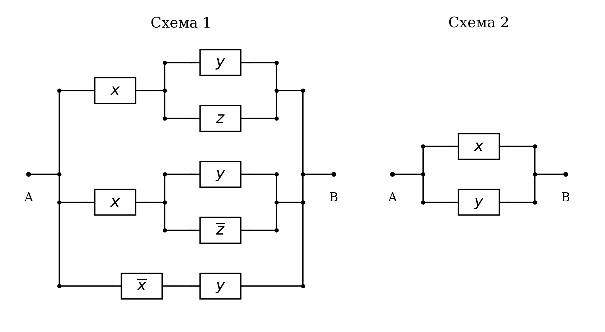
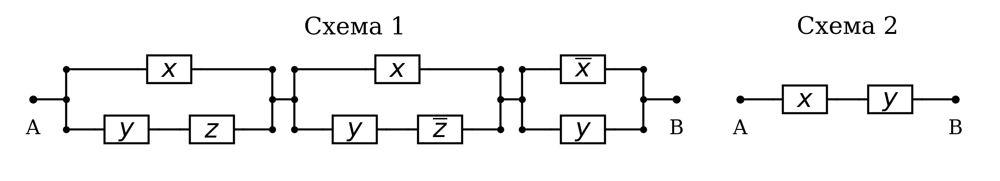

# Контрольная работа 2

| Параметр | Значение |
|---|---|
| Дисциплина | Информатика |
| Институт | ИРИП |
| Кафедра | Индустриального программирования |
| Вид учебного материала | Контрольная работа |
| Преподаватель | Александров Алексей Сергеевич |
| Семестр | 1 семестр |

## Вариант 1

Все задания выполняются письменно (на листе бумаги, или в редакторе Word).

### Задание 1 (5 баллов)

Дана логическая формула:

$$ F = ((x ∨ y) ∧ ¬x) → (y ∨ z). $$

Выразите импликацию через И, ИЛИ и НЕ и нарисуйте соответствующую релейно-контактную схему. Затем упростите формулу с помощью эквивалентных логических преобразований и нарисуйте упрощённую схему.

### Задание 2 (5 баллов)

Докажите эквивалентность схем 1 и 2. Запишите формулу для каждой схемы и докажите их эквивалентность с помощью эквивалентных логических преобразований. Укажите использованные законы.

### Задание 3 (10 баллов)

Возьмите последние две цифры номера своего студенческого билета. Замените каждый встречающийся среди них 0 на букву B. Получившиеся два символа считайте шестнадцатеричной записью вектора значений функции F(x, y, z). Переведите данную запись в двоичное восьмиразрядное число.

Например: 26T0438 → 38₁₆ → 00111000₂. Для окончания 40 получится 4B₁₆ → 01001011₂, для 07 — B7₁₆ → 10110111₂, для 00 — BB₁₆ → 10111011₂. Само число 38 переводить в шестнадцатеричную систему не нужно.

Биты вектора записывайте в столбец F сверху вниз в порядке строк таблицы. Первый бит слева относится к набору 000, последний справа — к набору 111.

| x | y | z | F |
|---|---|---|---|
0 | 0 | 0 | |
0 | 0 | 1 | |
0 | 1 | 0 | |
0 | 1 | 1 | |
1 | 0 | 0 | |
1 | 0 | 1 | |
1 | 1 | 0 | |
1 | 1 | 1 | |

По заполненной таблице составьте СДНФ функции F(x, y, z) и нарисуйте релейно-контактную схему непосредственно по полученной СДНФ.

Для решения задания в электронном виде можно применить Paint или сервис draw.io 

<!-- pagebreak -->

# Контрольная работа 2

## Вариант 2

Все задания выполняются письменно (на листе бумаги, или в редакторе Word).

### Задание 1 (5 баллов)

Дана логическая формула:

$$ F = (x → (y ∧ z)) ∧ x ∧ (¬y ∨ ¬z). $$

Выразите импликацию через И, ИЛИ и НЕ и нарисуйте соответствующую релейно-контактную схему. Затем упростите формулу с помощью эквивалентных логических преобразований и нарисуйте упрощённую схему.

### Задание 2 (5 баллов)

Докажите эквивалентность схем 1 и 2. Запишите формулу для каждой схемы и докажите их эквивалентность с помощью эквивалентных логических преобразований. Укажите использованные законы.

### Задание 3 (10 баллов)

Возьмите последние две цифры номера своего студенческого билета. Замените каждый встречающийся среди них 0 на букву B. Получившиеся два символа считайте шестнадцатеричной записью вектора значений функции F(x, y, z). Переведите данную запись в двоичное восьмиразрядное число.

Например: 26T0438 → 38₁₆ → 00111000₂. Для окончания 40 получится 4B₁₆ → 01001011₂, для 07 — B7₁₆ → 10110111₂, для 00 — BB₁₆ → 10111011₂. Само число 38 переводить в шестнадцатеричную систему не нужно.

Биты вектора записывайте в столбец F сверху вниз в порядке строк таблицы. Первый бит слева относится к набору 000, последний справа — к набору 111.

| x | y | z | F |
|---|---|---|---|
0 | 0 | 0 | |
0 | 0 | 1 | |
0 | 1 | 0 | |
0 | 1 | 1 | |
1 | 0 | 0 | |
1 | 0 | 1 | |
1 | 1 | 0 | |
1 | 1 | 1 | |

По заполненной таблице составьте СКНФ функции F(x, y, z) и нарисуйте релейно-контактную схему непосредственно по полученной СКНФ.

Для решения задания в электронном виде можно применить Paint или сервис draw.io 
