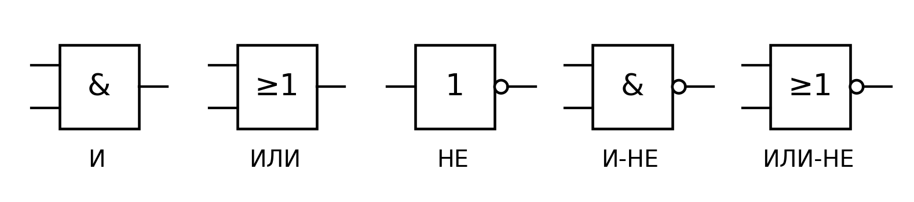
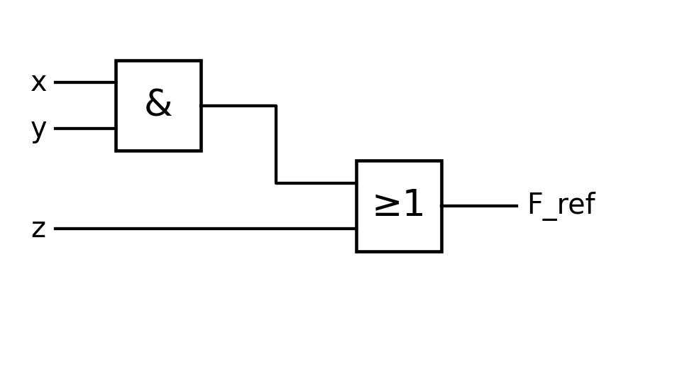
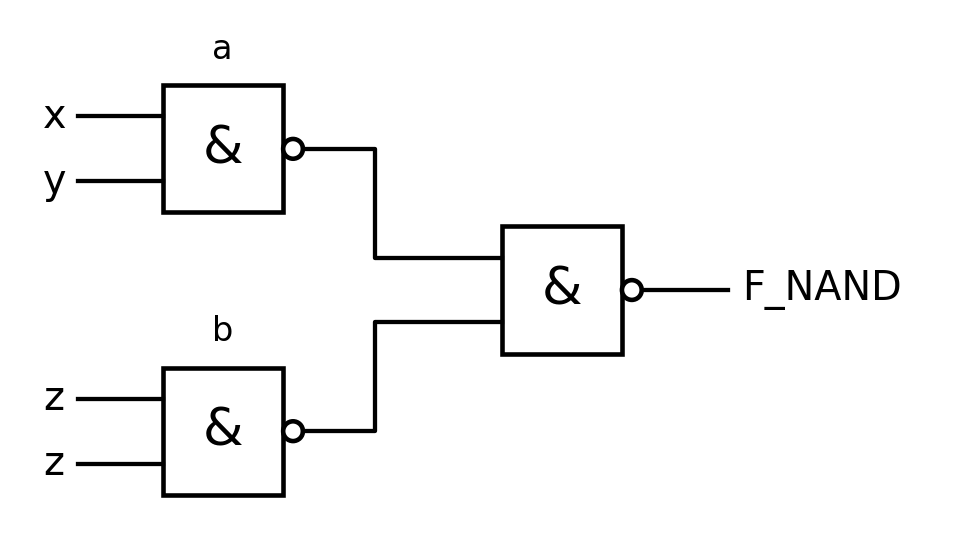
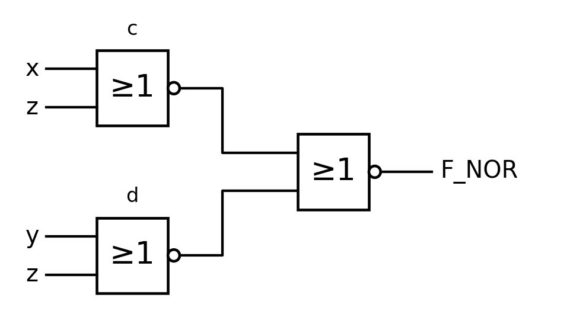

# Рабочая тетрадь № 7

## Информатика · Логические базисы И-НЕ и ИЛИ-НЕ

| Параметр | Значение |
|---|---|
| Дисциплина | Информатика |
| Институт | ИРИП |
| Кафедра | Индустриального программирования |
| Вид учебного материала | Методические указания к практическим занятиям |
| Преподаватель | Александров Алексей Сергеевич |
| Семестр | 1 семестр |
| Практическое занятие | № 12 |

## 1. Базисы И-НЕ и ИЛИ-НЕ

### 1.1. Теоретический материал

Операцию И-НЕ (NAND) обозначают штрихом Шеффера $\mid$, а ИЛИ-НЕ (NOR) — стрелкой Пирса $\downarrow$.

$$
x\mid y=\overline{x\wedge y},\qquad
x\downarrow y=\overline{x\vee y}.
$$

| $x$ | $y$ | $x\wedge y$ | $x\vee y$ | $x\mid y$ | $x\downarrow y$ |
|---|---|---|---|---|---|
| 0 | 0 | 0 | 0 | 1 | 1 |
| 0 | 1 | 0 | 1 | 1 | 0 |
| 1 | 0 | 0 | 1 | 1 | 0 |
| 1 | 1 | 1 | 1 | 0 | 0 |

Система операций называется функционально полной, если через неё можно выразить любую булеву функцию. НЕ, И и ИЛИ образуют такую систему. Чтобы доказать полноту базиса И-НЕ, достаточно выразить эти три операции через штрих Шеффера. Для ИЛИ-НЕ рассуждение такое же.

Напомним двойное отрицание и законы де Моргана. Здесь $A$ и $B$ могут быть любыми логическими выражениями.

$$
\overline{\overline{A}}=A,\qquad
\overline{A\wedge B}=\overline A\vee\overline B,\qquad
\overline{A\vee B}=\overline A\wedge\overline B.
$$

### 1.2. Примеры

**Задача**

Выразить операции НЕ, И и ИЛИ через штрих Шеффера.

**Решение**

Подадим $x$ на оба входа элемента И-НЕ. Так как $x\wedge x=x$, на выходе получим $\overline x$.

$$
\overline x=\overline{x\wedge x}=x\mid x.
$$

Чтобы получить $x\wedge y$, ещё раз инвертируем выход И-НЕ.

$$
x\wedge y=\overline{\overline{x\wedge y}}
=\overline{x\mid y}
=(x\mid y)\mid(x\mid y).
$$

Для ИЛИ воспользуемся двойным отрицанием и законом де Моргана.

$$
\begin{aligned}
x\vee y&=\overline{\overline{x\vee y}}
=\overline{\overline x\wedge\overline y}\\
&=\overline x\mid\overline y
=(x\mid x)\mid(y\mid y).
\end{aligned}
$$

**Задача**

Выразить операции НЕ, И и ИЛИ через стрелку Пирса.

**Решение**

У элемента ИЛИ-НЕ тоже достаточно соединить входы. Здесь $x\vee x=x$.

$$
\overline x=\overline{x\vee x}=x\downarrow x.
$$

И выразим через ИЛИ-НЕ по закону де Моргана.

$$
\begin{aligned}
x\wedge y&=\overline{\overline{x\wedge y}}
=\overline{\overline x\vee\overline y}\\
&=\overline x\downarrow\overline y
=(x\downarrow x)\downarrow(y\downarrow y).
\end{aligned}
$$

Для ИЛИ инвертируем выход элемента ИЛИ-НЕ.

$$
x\vee y=\overline{\overline{x\vee y}}
=\overline{x\downarrow y}
=(x\downarrow y)\downarrow(x\downarrow y).
$$

Одинаковые скобки $(x\mid y)$ в схеме вычисляются один раз. Выход элемента подаётся на оба входа следующего. То же относится к $(x\downarrow y)$.

### 1.3. Задания

**Задание 1.1**

Найдите значения выражений $0\mid1$, $1\mid1$, $0\downarrow0$ и $1\downarrow0$. Для каждого выражения запишите вычисление цепочкой равенств.

**Решение и ответ**

____________________________________________________________

**Задание 1.2**

Выразите ИЛИ через штрих Шеффера, а И — через стрелку Пирса. Проверьте одно из полученных равенств по таблице истинности.

**Решение и ответ**

____________________________________________________________

## 2. Преобразование логических формул

### 2.1. Теоретический материал

Начнём с операции, которая выполняется последней. Например, $(x\wedge y)\vee z$ имеет вид $A\vee B$, где $A=x\wedge y$, $B=z$. Заменим внешнюю операцию по одному из равенств.

$$
\begin{aligned}
A\vee B&=\overline{\overline{A\vee B}}
=\overline{\overline A\wedge\overline B}
=\overline A\mid\overline B,\\
A\wedge B&=\overline{\overline{A\wedge B}}
=\overline{\overline A\vee\overline B}
=\overline A\downarrow\overline B.
\end{aligned}
$$

Дальше заменяем операции внутри скобок по формулам из раздела 1.2. Импликацию и исключающее ИЛИ сначала выражаем через НЕ, И и ИЛИ.

### 2.2. Примеры

**Задача**

Выразить функцию $F_1=(x\wedge y)\vee z$ в базисах И-НЕ и ИЛИ-НЕ.

**Решение**

Для И-НЕ добавим двойное отрицание и применим закон де Моргана к внутренней черте.

$$
\begin{aligned}
F_1&=(x\wedge y)\vee z
=\overline{\overline{(x\wedge y)\vee z}}
=\overline{\overline{x\wedge y}\wedge\overline z}\\
&=\overline{x\wedge y}\mid\overline z
=(x\mid y)\mid(z\mid z).
\end{aligned}
$$

Для ИЛИ-НЕ сначала получим внешнее И. Применим закон $A\vee(B\wedge C)=(A\vee B)\wedge(A\vee C)$ при $A=z$, $B=x$, $C=y$.

$$
\begin{aligned}
F_1&=(x\wedge y)\vee z
=(x\vee z)\wedge(y\vee z)\\
&=\overline{\overline{(x\vee z)\wedge(y\vee z)}}
=\overline{\overline{x\vee z}\vee\overline{y\vee z}}\\
&=\overline{x\vee z}\downarrow\overline{y\vee z}
=(x\downarrow z)\downarrow(y\downarrow z).
\end{aligned}
$$

**Задача**

Выразить функцию $F_2=(\overline x\wedge y)\vee(x\wedge z)$ в базисах И-НЕ и ИЛИ-НЕ.

**Решение**

Переведём дизъюнкцию в И-НЕ, как в предыдущем примере. В конце заменим $\overline x$ на $x\mid x$.

$$
\begin{aligned}
F_2&=(\overline x\wedge y)\vee(x\wedge z)
=\overline{\overline{(\overline x\wedge y)\vee(x\wedge z)}}\\
&=\overline{\overline{\overline x\wedge y}\wedge\overline{x\wedge z}}
=\overline{\overline x\wedge y}\mid\overline{x\wedge z}\\
&=(\overline x\mid y)\mid(x\mid z)
=((x\mid x)\mid y)\mid(x\mid z).
\end{aligned}
$$

**Переход к ИЛИ-НЕ**

Сначала приведём $F_2$ к КНФ. Применим тот же распределительный закон при $A=\overline x\wedge y$, $B=x$, $C=z$, затем применим его к каждой полученной скобке. Множитель $(\overline x\vee x)$ равен 1.

$$
\begin{aligned}
F_2
&=(\overline x\wedge y)\vee(x\wedge z)\\
&=((\overline x\wedge y)\vee x)\wedge((\overline x\wedge y)\vee z)\\
&=(\overline x\vee x)\wedge(y\vee x)
  \wedge(\overline x\vee z)\wedge(y\vee z)\\
&=1\wedge(x\vee y)\wedge(\overline x\vee z)\wedge(y\vee z)\\
&=(x\vee y)\wedge(\overline x\vee z)\wedge(y\vee z).
\end{aligned}
$$

Проверим скобку $(y\vee z)$. Она равна 1, если $y=1$ или $z=1$. При $y=z=0$ первые две скобки уже дают 0.

$$
(x\vee 0)\wedge(\overline x\vee 0)=x\wedge\overline x=0.
$$

Поэтому последнюю скобку можно убрать. Переведём полученную КНФ в ИЛИ-НЕ.

$$
\begin{aligned}
F_2&=(x\vee y)\wedge(\overline x\vee z)\wedge(y\vee z)\\
&=(x\vee y)\wedge(\overline x\vee z)
=\overline{\overline{(x\vee y)\wedge(\overline x\vee z)}}\\
&=\overline{\overline{x\vee y}\vee\overline{\overline x\vee z}}
=\overline{x\vee y}\downarrow\overline{\overline x\vee z}\\
&=(x\downarrow y)\downarrow(\overline x\downarrow z)
=(x\downarrow y)\downarrow((x\downarrow x)\downarrow z).
\end{aligned}
$$

**Задача**

Выразить импликацию $x\rightarrow y$ в базисах И-НЕ и ИЛИ-НЕ. Затем выполнить то же преобразование для функции $(x\rightarrow y)\wedge z$.

**Решение**

Импликация $x\rightarrow y$ и дизъюнкция $\overline x\vee y$ ложны только на наборе $10$. Этим равенством воспользуемся в обоих базисах.

$$
\begin{aligned}
x\rightarrow y&=\overline x\vee y
=\overline{\overline{\overline x\vee y}}
=\overline{\overline{\overline x}\wedge\overline y}\\
&=\overline{x\wedge\overline y}
=x\mid\overline y=x\mid(y\mid y).
\end{aligned}
$$

Через ИЛИ-НЕ получим

$$
\begin{aligned}
x\rightarrow y&=\overline x\vee y
=\overline{\overline{\overline x\vee y}}
=\overline{\overline x\downarrow y}\\
&=(\overline x\downarrow y)\downarrow(\overline x\downarrow y)\\
&=((x\downarrow x)\downarrow y)\downarrow((x\downarrow x)\downarrow y).
\end{aligned}
$$

Теперь добавим $z$. В записи через И-НЕ обозначим импликацию через $p=x\mid(y\mid y)$.

$$
\begin{aligned}
(x\rightarrow y)\wedge z&=p\wedge z
=\overline{\overline{p\wedge z}}
=\overline{p\mid z}=(p\mid z)\mid(p\mid z).
\end{aligned}
$$

Для ИЛИ-НЕ применим закон де Моргана ко всей конъюнкции.

$$
\begin{aligned}
(x\rightarrow y)\wedge z
&=(\overline x\vee y)\wedge z
=\overline{\overline{(\overline x\vee y)\wedge z}}\\
&=\overline{\overline{\overline x\vee y}\vee\overline z}
=\overline{\overline x\vee y}\downarrow\overline z\\
&=(\overline x\downarrow y)\downarrow(z\downarrow z)
=((x\downarrow x)\downarrow y)\downarrow(z\downarrow z).
\end{aligned}
$$

**Задача**

Выразить исключающее ИЛИ $x\oplus y$ в базисах И-НЕ и ИЛИ-НЕ.

**Решение**

Исключающее ИЛИ равно 1 на наборах $01$ и $10$. Запишем ДНФ по этим строкам.

$$
\begin{aligned}
x\oplus y&=(\overline x\wedge y)\vee(x\wedge\overline y)\\
&=\overline{\overline{(\overline x\wedge y)\vee(x\wedge\overline y)}}
=\overline{\overline{\overline x\wedge y}\wedge\overline{x\wedge\overline y}}\\
&=\overline{\overline x\wedge y}\mid\overline{x\wedge\overline y}
=(\overline x\mid y)\mid(x\mid\overline y)\\
&=((x\mid x)\mid y)\mid(x\mid(y\mid y)).
\end{aligned}
$$

**Как сократить схему И-НЕ**

Выше понадобились отдельные элементы для $\overline x$ и $\overline y$. Можно обойтись одним общим сигналом. Добавим к $x\wedge\overline y$ нулевой член $x\wedge\overline x$, а к $\overline x\wedge y$ — $\overline y\wedge y$. Затем вынесем общий множитель в каждой строке.

$$
\begin{aligned}
x\wedge\overline y
&=(x\wedge\overline x)\vee(x\wedge\overline y)
=x\wedge(\overline x\vee\overline y),\\
\overline x\wedge y
&=(\overline x\wedge y)\vee(\overline y\wedge y)
=(\overline x\vee\overline y)\wedge y.
\end{aligned}
$$

Общая скобка в двух строках — $\overline x\vee\overline y$. Обозначим её значение через $t$.

$$
t=\overline x\vee\overline y=\overline{x\wedge y}=x\mid y.
$$

Подставим $t$ в ДНФ.

$$
\begin{aligned}
x\oplus y&=(\overline x\wedge y)\vee(x\wedge\overline y)
=(t\wedge y)\vee(x\wedge t)\\
&=(x\wedge t)\vee(y\wedge t)
=\overline{\overline{(x\wedge t)\vee(y\wedge t)}}\\
&=\overline{\overline{x\wedge t}\wedge\overline{y\wedge t}}
=\overline{x\wedge t}\mid\overline{y\wedge t}\\
&=(x\mid t)\mid(y\mid t).
\end{aligned}
$$

На всю схему ушло четыре элемента И-НЕ, включая элемент для $t$.

Для ИЛИ-НЕ возьмём нулевые наборы $00$ и $11$. На первом равна 0 скобка $(x\vee y)$, на втором — $(\overline x\vee\overline y)$. Соединим скобки через И.

$$
\begin{aligned}
x\oplus y
&=(x\vee y)\wedge(\overline x\vee\overline y)\\
&=\overline{\overline{(x\vee y)\wedge(\overline x\vee\overline y)}}
=\overline{\overline{x\vee y}\vee\overline{\overline x\vee\overline y}}\\
&=\overline{x\vee y}\downarrow\overline{\overline x\vee\overline y}
=(x\downarrow y)\downarrow(\overline x\downarrow\overline y)\\
&=(x\downarrow y)\downarrow((x\downarrow x)\downarrow(y\downarrow y)).
\end{aligned}
$$

**Задача**

Выразить функцию $(x\oplus y)\vee z$ в базисах И-НЕ и ИЛИ-НЕ.

**Решение**

Пусть $p=x\oplus y$. Возьмём готовое выражение для $p$ в каждом базисе. Для И-НЕ используем схему с общим сигналом $t=x\mid y$.

$$
\begin{aligned}
p&=x\oplus y=(x\mid t)\mid(y\mid t),\\
(x\oplus y)\vee z&=p\vee z
=\overline{\overline{p\vee z}}
=\overline{\overline p\wedge\overline z}
=\overline p\mid\overline z
=(p\mid p)\mid(z\mid z).
\end{aligned}
$$

В базисе ИЛИ-НЕ получим

$$
\begin{aligned}
p&=x\oplus y=(x\downarrow y)\downarrow((x\downarrow x)\downarrow(y\downarrow y)),\\
(x\oplus y)\vee z&=p\vee z
=\overline{\overline{p\vee z}}
=\overline{p\downarrow z}=(p\downarrow z)\downarrow(p\downarrow z).
\end{aligned}
$$

### 2.3. Задания

**Задание 2.1**

Выразите $(\overline x\wedge y)\vee z$ через штрих Шеффера.

**Решение и ответ**

____________________________________________________________

**Задание 2.2**

Постройте таблицы истинности для четырёхэлементной схемы И-НЕ и схемы ИЛИ-НЕ, реализующих исключающее ИЛИ. Сравните результаты на всех четырёх наборах.

**Решение и ответ**

____________________________________________________________

**Задание 2.3**

Выразите $(x\vee y)\wedge z$ и $(x\rightarrow y)\vee z$ в обоих базисах. Для $(x\oplus y)\wedge z$ выберите один из двух базисов.

**Решение и ответ**

____________________________________________________________

## 3. СДНФ и СКНФ в логических базисах

### 3.1. Теоретический материал

Вспомним, как строятся СДНФ и СКНФ по таблице истинности. Возьмём для примера строку $010$ в порядке $x,y,z$.

- Если функция на строке равна 1, в СДНФ берём $\overline x\wedge y\wedge\overline z$. На наборе $010$ эта конъюнкция равна 1. Все такие конъюнкции соединяем через ИЛИ.
- Если функция равна 0, в СКНФ берём $x\vee\overline y\vee z$. На наборе $010$ эта дизъюнкция равна 0. Все такие дизъюнкции соединяем через И.

**Как разбить выражение на пары**

Если в скобке три переменные, сначала вычисляем И или ИЛИ для двух из них. Для И используем два элемента И-НЕ, для ИЛИ — два элемента ИЛИ-НЕ. Затем подаём промежуточный результат и третью переменную на следующий элемент.

$$
\begin{aligned}
\overline{a\wedge b\wedge c}
&=\overline{(a\wedge b)\wedge c}
=(a\wedge b)\mid c
=((a\mid b)\mid(a\mid b))\mid c,\\
\overline{a\vee b\vee c}
&=\overline{(a\vee b)\vee c}
=(a\vee b)\downarrow c
=((a\downarrow b)\downarrow(a\downarrow b))\downarrow c.
\end{aligned}
$$

Во внутренней паре нужно восстановить И или ИЛИ. Если пропустить эту инверсию, получится другая функция. Например, $(1\mid1)\mid1=0\mid1=1$, а $\overline{1\wedge1\wedge1}=\overline1=0$.

**Как соединить скобки**

Для СДНФ получаем отрицания конъюнкций $t_i=\overline{K_i}$. По де Моргану $K_1\vee K_2\vee\ldots=\overline{t_1\wedge t_2\wedge\ldots}$. Пока сигналов больше двух, заменяем любую пару её конъюнкцией. Два оставшихся сигнала подаём на И-НЕ. Для СКНФ получаем $u_i=\overline{D_i}$ и используем $D_1\wedge D_2\wedge\ldots=\overline{u_1\vee u_2\vee\ldots}$. Здесь пары заменяем дизъюнкциями, пока не останутся два сигнала для ИЛИ-НЕ. Если скобка одна, просто инвертируем $t_1$ или $u_1$, подав сигнал на оба входа элемента.

### 3.2. Пример

**Задача**

Для $F_2=(\overline x\wedge y)\vee(x\wedge z)$ составить таблицу истинности, СДНФ и СКНФ. По СДНФ построить запись в базисе И-НЕ, по СКНФ — в базисе ИЛИ-НЕ.

**Решение**

Для примера подставим в $F_2$ значения из строки $010$. Остальные строки заполним так же.

$$
\begin{aligned}
F_2(0,1,0)&=(\overline 0\wedge1)\vee(0\wedge0)
=(1\wedge1)\vee(0\wedge0)=1\vee0=1.
\end{aligned}
$$

| $x$ | $y$ | $z$ | $\overline x\wedge y$ | $x\wedge z$ | $F_2$ |
|---|---|---|---|---|---|
| 0 | 0 | 0 | 0 | 0 | 0 |
| 0 | 0 | 1 | 0 | 0 | 0 |
| 0 | 1 | 0 | 1 | 0 | 1 |
| 0 | 1 | 1 | 1 | 0 | 1 |
| 1 | 0 | 0 | 0 | 0 | 0 |
| 1 | 0 | 1 | 0 | 1 | 1 |
| 1 | 1 | 0 | 0 | 0 | 0 |
| 1 | 1 | 1 | 0 | 1 | 1 |

Из строк $010,011,101,111$ получаем СДНФ.

$$
\begin{aligned}
F_{\text{СДНФ}}
&=(\overline x\wedge y\wedge\overline z)\vee(\overline x\wedge y\wedge z)\\
&\quad\vee(x\wedge\overline y\wedge z)\vee(x\wedge y\wedge z).
\end{aligned}
$$

Из строк $000,001,100,110$ получаем СКНФ.

$$
\begin{aligned}
F_{\text{СКНФ}}
&=(x\vee y\vee z)\wedge(x\vee y\vee\overline z)\\
&\quad\wedge(\overline x\vee y\vee z)\wedge(\overline x\vee\overline y\vee z).
\end{aligned}
$$

**СДНФ в базисе И-НЕ**

Обозначим конъюнкции через $K_1,\ldots,K_4$ в порядке записи. Инверсии входов получаем через И-НЕ: $n_x=\overline x=x\mid x$, $n_y=\overline y=y\mid y$, $n_z=\overline z=z\mid z$. У первых двух конъюнкций общая часть $\overline x\wedge y$, у последних двух — $x\wedge z$. Вычислим каждую пару один раз.

$$
\begin{aligned}
p_1&=n_x\wedge y=(n_x\mid y)\mid(n_x\mid y),\\
p_2&=x\wedge z=(x\mid z)\mid(x\mid z).
\end{aligned}
$$

К каждой паре добавим оставшуюся переменную.

$$
\begin{aligned}
t_1&=\overline{K_1}=\overline{p_1\wedge n_z}=p_1\mid n_z,\\
t_2&=\overline{K_2}=\overline{p_1\wedge z}=p_1\mid z,\\
t_3&=\overline{K_3}=\overline{p_2\wedge n_y}=p_2\mid n_y,\\
t_4&=\overline{K_4}=\overline{p_2\wedge y}=p_2\mid y.
\end{aligned}
$$

Разобьём сигналы $t_1,\ldots,t_4$ на две пары и вычислим их конъюнкции.

$$
\begin{aligned}
q_1&=t_1\wedge t_2=(t_1\mid t_2)\mid(t_1\mid t_2),\\
q_2&=t_3\wedge t_4=(t_3\mid t_4)\mid(t_3\mid t_4).
\end{aligned}
$$

$$
\begin{aligned}
F_2&=K_1\vee K_2\vee K_3\vee K_4
=\overline{\overline{K_1\vee K_2\vee K_3\vee K_4}}\\
&=\overline{(t_1\wedge t_2)\wedge(t_3\wedge t_4)}
=\overline{q_1\wedge q_2}=q_1\mid q_2.
\end{aligned}
$$

**СКНФ в базисе ИЛИ-НЕ**

Дизъюнкции обозначим через $D_1,\ldots,D_4$. Инверсии входов получаем через ИЛИ-НЕ: $m_x=\overline x=x\downarrow x$, $m_y=\overline y=y\downarrow y$, $m_z=\overline z=z\downarrow z$. Общие пары здесь — $x\vee y$ и $\overline x\vee z$.

$$
\begin{aligned}
r_1&=x\vee y=(x\downarrow y)\downarrow(x\downarrow y),\\
r_2&=m_x\vee z=(m_x\downarrow z)\downarrow(m_x\downarrow z).
\end{aligned}
$$

$$
\begin{aligned}
u_1&=\overline{D_1}=\overline{r_1\vee z}=r_1\downarrow z,\\
u_2&=\overline{D_2}=\overline{r_1\vee m_z}=r_1\downarrow m_z,\\
u_3&=\overline{D_3}=\overline{r_2\vee y}=r_2\downarrow y,\\
u_4&=\overline{D_4}=\overline{r_2\vee m_y}=r_2\downarrow m_y.
\end{aligned}
$$

Для двух пар $u_1,u_2$ и $u_3,u_4$ вычислим ИЛИ.

$$
\begin{aligned}
s_1&=u_1\vee u_2=(u_1\downarrow u_2)\downarrow(u_1\downarrow u_2),\\
s_2&=u_3\vee u_4=(u_3\downarrow u_4)\downarrow(u_3\downarrow u_4).
\end{aligned}
$$

$$
\begin{aligned}
F_2&=D_1\wedge D_2\wedge D_3\wedge D_4
=\overline{\overline{D_1\wedge D_2\wedge D_3\wedge D_4}}\\
&=\overline{(u_1\vee u_2)\vee(u_3\vee u_4)}
=\overline{s_1\vee s_2}=s_1\downarrow s_2.
\end{aligned}
$$

В каждой схеме по 16 элементов. Одинаковое промежуточное выражение вычисляем один раз и подаём его выход на нужные входы. В разделе 2.2 для той же функции хватило четырёх элементов благодаря упрощению исходной формулы.

### 3.3. Задания

**Задание 3.1**

Функция $F(x,y,z)$ равна 1 на наборах $001$, $010$, $101$ и $111$. На остальных наборах она равна 0. Постройте СДНФ и СКНФ. Преобразуйте СДНФ в базис И-НЕ, а СКНФ — в базис ИЛИ-НЕ. Используйте только двухвходовые элементы.

**Решение и ответ**

____________________________________________________________

**Задание 3.2**

Найдите набор, на котором $(x\downarrow y)\downarrow z$ и $x\downarrow(y\downarrow z)$ принимают разные значения.

**Решение и ответ**

____________________________________________________________

## 4. Построение схем в Logisim

### 4.1. Теоретический материал

В прямоугольных обозначениях «&» соответствует И, «≥1» — ИЛИ. Кружок на выходе означает отрицание.

### 4.2. Пример

**Задача**

Построить три схемы функции $F_1=(x\wedge y)\vee z$: исходную, в базисе И-НЕ и в базисе ИЛИ-НЕ. Сравнить их по таблицам истинности.

**Решение**

В классическом Logisim прямоугольные элементы включаются через `File → Preferences → International → Gate shape → Rectangular`.

В новом проекте разместим три входа $x,y,z$ и три выхода `F_ref`, `F_NAND`, `F_NOR`. Контакты добавляем через `Wiring → Pin`. Для всех контактов ставим `Data Bits = 1`, для входов — `Output? = No`, для выходов — `Output? = Yes`.

Элементы выбираем в `Gates`. В этом примере у каждого элемента два входа (`Number of Inputs = 2`) и разрядность 1 (`Data Bits = 1`).

В исходной схеме выход И с входами $x,y$ подаём на ИЛИ вместе с $z$. Выход ИЛИ подключаем к `F_ref`.

Схему И-НЕ собираем по формуле $(x\mid y)\mid(z\mid z)$. Два первых элемента дают $a=x\mid y$ и $b=z\mid z$. Третий вычисляет $a\mid b$ и подаёт результат на `F_NAND`.

В схеме ИЛИ-НЕ сначала получаем $c=x\downarrow z$ и $d=y\downarrow z$. Выход третьего элемента $c\downarrow d$ подключаем к `F_NOR`.

Подключим все три схемы к общим входам. Сборку можно сверить с `logisim/01_compare_F1.circ`. В этом файле туннели (`Tunnel`) с одинаковыми метками соединяют участки одной цепи.

Откроем `Project → Analyze Circuit` и проверим таблицу истинности. Входы читаем в порядке $x,y,z$. Если анализ недоступен, меняем входы инструментом `Poke`. Все три столбца должны совпасть.

| $x$ | $y$ | $z$ | Исходная | И-НЕ | ИЛИ-НЕ |
|---|---|---|---|---|---|
| 0 | 0 | 0 | 0 | 0 | 0 |
| 0 | 0 | 1 | 1 | 1 | 1 |
| 0 | 1 | 0 | 0 | 0 | 0 |
| 0 | 1 | 1 | 1 | 1 | 1 |
| 1 | 0 | 0 | 0 | 0 | 0 |
| 1 | 0 | 1 | 1 | 1 | 1 |
| 1 | 1 | 0 | 1 | 1 | 1 |
| 1 | 1 | 1 | 1 | 1 | 1 |

Выходы можно сравнить прямо в схеме. Подадим $F_{\text{исх}}$ и каждый из двух других выходов на отдельный элемент исключающего ИЛИ. Объединим результаты через ИЛИ. Тогда $E=1$ при любом расхождении.

$$
E=(F_{\text{исх}}\oplus F_{\text{И-НЕ}})\vee(F_{\text{исх}}\oplus F_{\text{ИЛИ-НЕ}}).
$$

Если выходы совпали, оба сравнения дают ноль. Например, для набора $110$ получаем

$$
E(1,1,0)=(1\oplus1)\vee(1\oplus1)=0\vee0=0.
$$

После правки соединений запустите анализ ещё раз.

[Документация Logisim по анализу комбинационных схем](https://cburch.com/logisim/docs/2.7/en/html/guide/analyze/open.html)

### 4.3. Задания

**Задание 4.1**

Откройте `logisim/02_xor_bases.circ`. Сравните три выхода на всех четырёх наборах. Найдите в схеме И-НЕ сигнал $t=x\mid y$ и укажите, на какие элементы он поступает.

**Решение и ответ**

____________________________________________________________

**Задание 4.2**

Откройте `logisim/03_canonical_F2.circ`. Сопоставьте сигналы схем с решением из раздела 3.2. Сравните выходы на восьми наборах и посчитайте число элементов в каждой реализации. Контрольные таблицы для примеров находятся в папке `tables`.

**Решение и ответ**

____________________________________________________________

## 5. Практическое задание

Номер варианта — последняя цифра номера студенческого билета. Если номер заканчивается на 0, выполняйте вариант 0.

| Вариант | Функция $F(x,y,z)$ |
|---|---|
| 0 | $x\wedge(y\vee\overline z)$ |
| 1 | $(x\vee y)\wedge z$ |
| 2 | $(x\rightarrow y)\vee z$ |
| 3 | $(x\oplus y)\wedge z$ |
| 4 | $(\overline x\wedge z)\vee y$ |
| 5 | $(x\rightarrow z)\wedge y$ |
| 6 | $(x\vee y)\wedge\overline z$ |
| 7 | $x\oplus(y\wedge z)$ |
| 8 | $(x\rightarrow y)\oplus z$ |
| 9 | $(x\wedge y)\rightarrow z$ |

**Задание 5.1**

Выразите функцию своего варианта в базисе И-НЕ или ИЛИ-НЕ, используя только двухвходовые элементы. Запишите преобразование цепочкой равенств.

**Задание 5.2**

Постройте таблицу истинности, СДНФ и СКНФ. Если вы выбрали И-НЕ, преобразуйте СДНФ в этот базис. Если вы выбрали ИЛИ-НЕ, преобразуйте СКНФ. Скобки и промежуточные сигналы объединяйте попарно, как в разделе 3.

**Задание 5.3**

Соберите в Logisim исходную схему и одну из схем по формулам из заданий 5.1 и 5.2. Импликацию в исходной схеме замените через НЕ и ИЛИ. У элементов выбранного базиса установите `Number of Inputs = 2`. Сравните выходы на всех восьми наборах, посчитайте элементы и сохраните файл `workbook7_Фамилия.circ`. Можно взять заготовку `logisim/04_student_template.circ` и удалить лишние выходы.

| $x$ | $y$ | $z$ | Исходная схема | Схема в выбранном базисе |
|---|---|---|---|---|
| 0 | 0 | 0 | | |
| 0 | 0 | 1 | | |
| 0 | 1 | 0 | | |
| 0 | 1 | 1 | | |
| 1 | 0 | 0 | | |
| 1 | 0 | 1 | | |
| 1 | 1 | 0 | | |
| 1 | 1 | 1 | | |

**Задание со звёздочкой**

Соберите вторую реализацию в том же базисе и сравните число элементов. Затем реализуйте функцию в другом базисе.

### 5.1. Защита работы

Для защиты подготовьте преобразования, СДНФ, СКНФ, таблицу истинности и файл схемы. Покажите, как в схеме получается отрицание и как вы проверили совпадение выходов. Считайте логические элементы каждой реализации отдельно.

1. Как получить НЕ с помощью одного элемента И-НЕ или ИЛИ-НЕ?
2. На каком шаге преобразования применяется двойное отрицание?
3. Почему при переходе от СДНФ удобно использовать И-НЕ, а при переходе от СКНФ — ИЛИ-НЕ?
4. Почему $(x\mid y)\mid z$ может дать другой результат, чем $\overline{x\wedge y\wedge z}$?
5. Сколько входных наборов нужно проверить для функции трёх переменных?

## 6. Дополнительный материал. Перенос и переполнение

### 6.1. Теоретический материал

В восьмиразрядной сетке от двоичной суммы остаются младшие восемь бит. Единица в девятом разряде даёт перенос $C_{out}=1$. Знаковое переполнение $OVF=1$ возникает, если сумма исходных чисел выходит за диапазон дополнительного кода от $-128$ до $127$.

Пусть $a_s$, $b_s$ — знаковые биты слагаемых, а $s_s$ — знаковый бит результата. При сложении переполнение возникает, когда знаки слагаемых совпадают, а знак результата меняется. Совпадение проверяем выражением $\overline{a_s\oplus b_s}$, смену знака — выражением $a_s\oplus s_s$.

$$
OVF=\overline{a_s\oplus b_s}\wedge(a_s\oplus s_s).
$$

### 6.2. Примеры

**Задача**

Сложить $-1$ и $1$ в восьмиразрядной сетке. Определить выходной перенос и знаковое переполнение.

**Решение**

Сложим коды `11111111` и `00000001`.

$$
\begin{aligned}
(11111111)_2+(00000001)_2&=(100000000)_2,\\
(00000000)_{\text{ДК}}&=0=-1+1.
\end{aligned}
$$

Девятый бит равен 1, поэтому $C_{out}=1$. Знаковое переполнение отсутствует.

$$
OVF=\overline{1\oplus0}\wedge(1\oplus0)=\overline1\wedge1=0\wedge1=0.
$$

**Задача**

Сложить $90$ и $50$ в восьмиразрядной сетке. Определить выходной перенос и знаковое переполнение.

**Решение**

Сложим `01011010` и `00110010`. Девятый бит равен 0. В сохранённом коде старший бит равен 1 и в дополнительном коде имеет вес $-128$.

$$
\begin{aligned}
(01011010)_2+(00110010)_2&=(10001100)_2,\\
(10001100)_{\text{ДК}}&=-128+8+4=-116,\\
90+50&=140.
\end{aligned}
$$

Математическая сумма превышает $127$. Проверим признак переполнения по знаковым битам.

$$
OVF=\overline{0\oplus0}\wedge(0\oplus1)=\overline0\wedge1=1\wedge1=1.
$$

### 6.3. Задание

Выполните сложение в восьмиразрядной сетке для $100+40$, $-100+(-40)$ и $-20+15$. Запишите коды операндов, сохранённый код суммы, $C_{out}$ и $OVF$. Выразите формулу для $OVF$ в одном из изученных базисов.

**Решение и ответ**

____________________________________________________________
