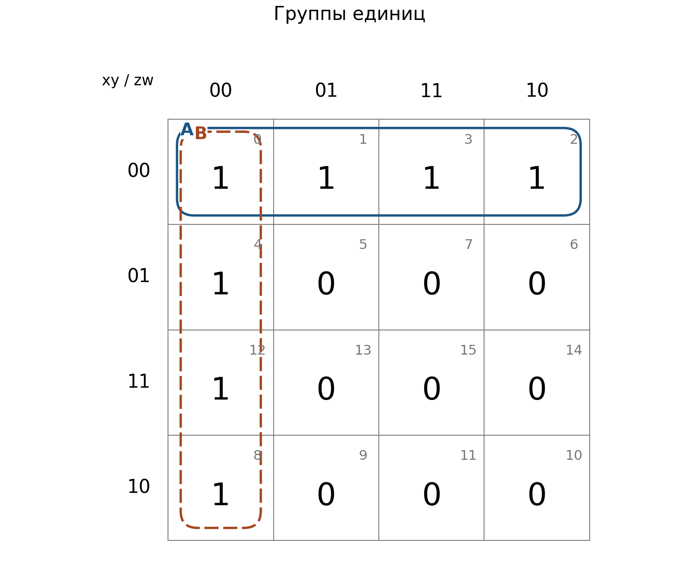
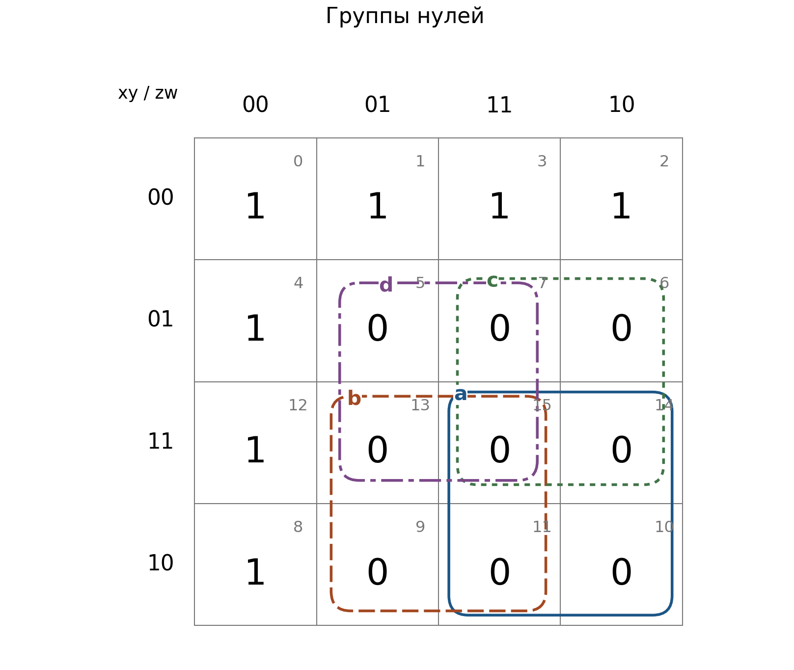
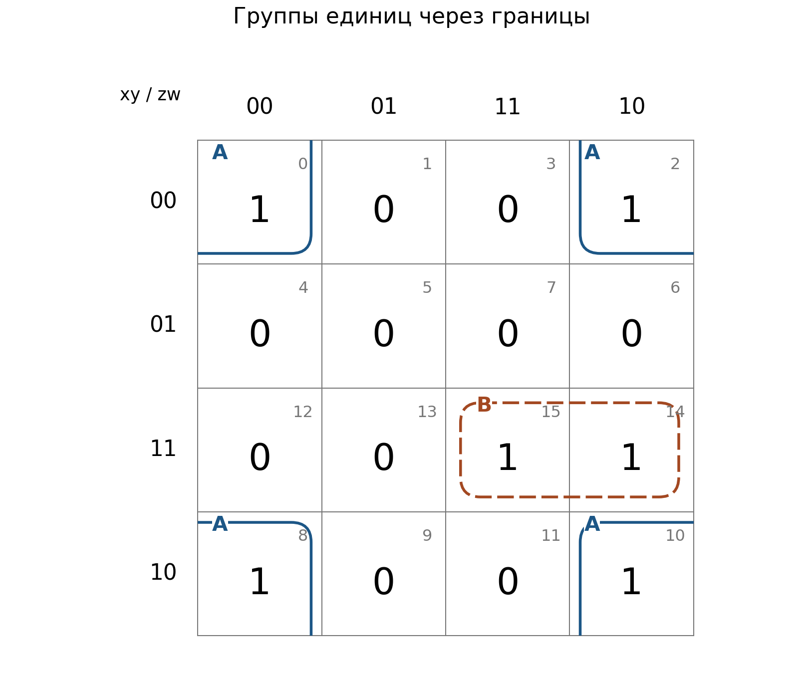
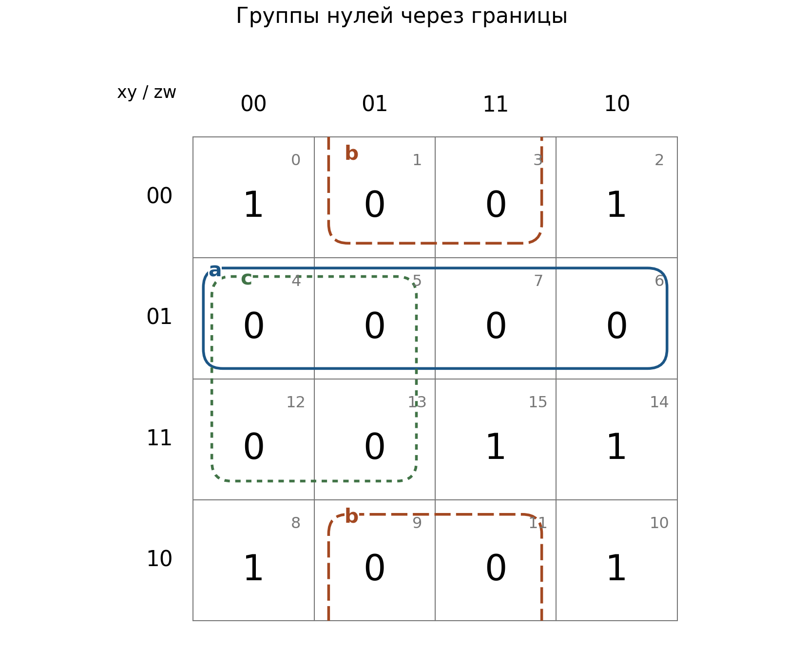
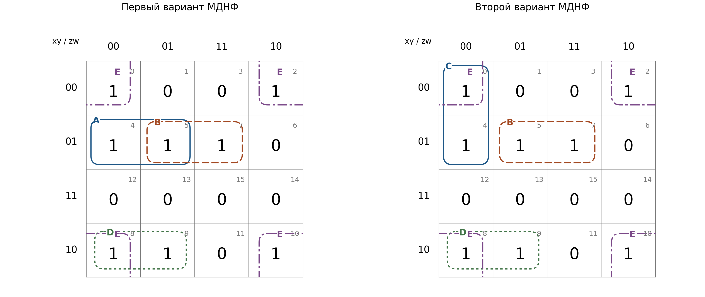
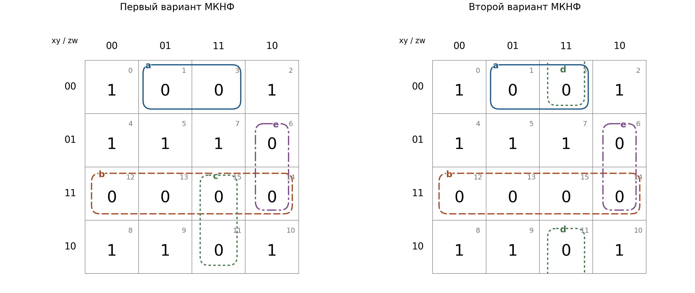
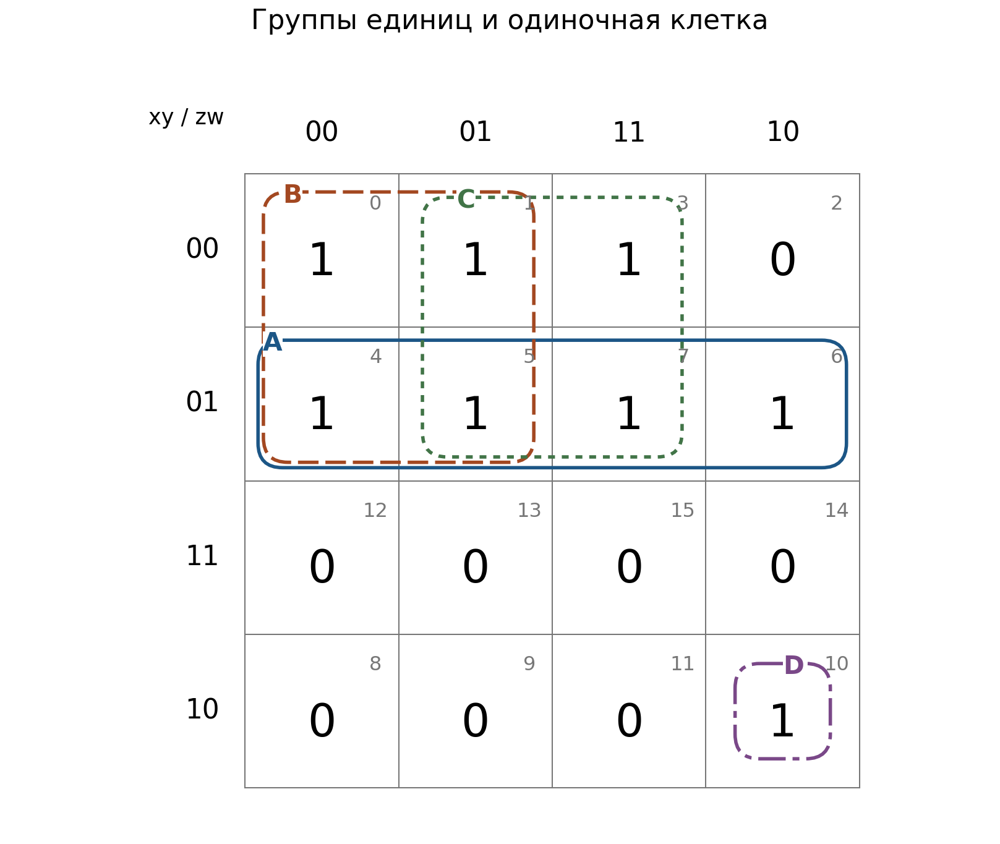
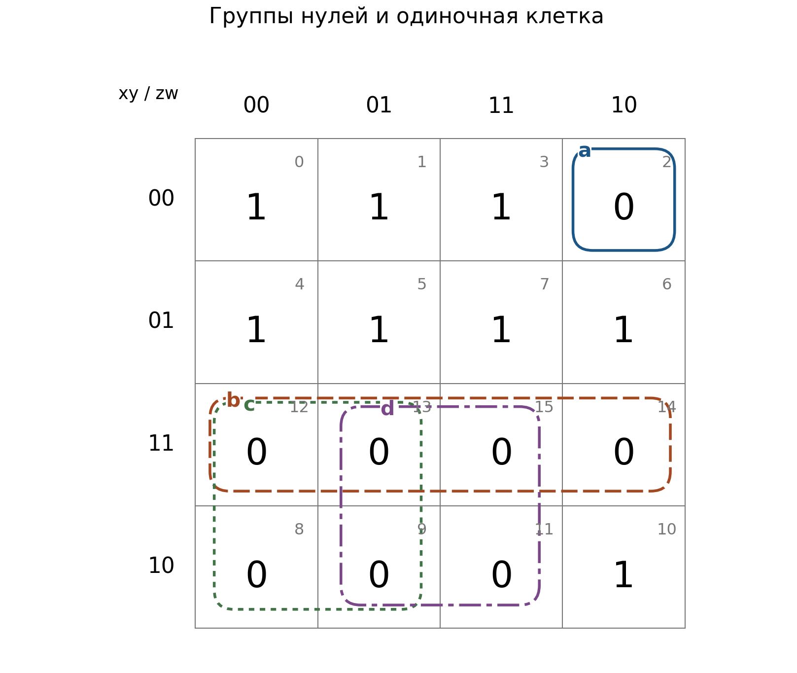

# Рабочая тетрадь № 8

## Информатика · Минимизация логических функций

| Параметр | Значение |
|---|---|
| Дисциплина | Информатика |
| Институт | ИРИП |
| Кафедра | Индустриального программирования |
| Вид учебного материала | Методические указания к практическим занятиям |
| Преподаватель | Александров Алексей Сергеевич |
| Семестр | 1 семестр |

В предыдущих работах мы строили СДНФ и СКНФ по таблице истинности. Такая запись однозначно задаёт функцию, но часто содержит лишние переменные и скобки. Теперь найдём минимальные формы двумя способами: методом Куайна — Мак-Класски и с помощью карт Карно. Полученные формулы проверим в Logisim.

## 1. Метод Куайна — Мак-Класски

### 1.1. Теоретический материал

**Минимальная дизъюнктивная нормальная форма (МДНФ)** — ДНФ с наименьшим числом вхождений переменных среди всех ДНФ данной функции. **Минимальная конъюнктивная нормальная форма (МКНФ)** определяется так же для КНФ. В этой работе считаем каждое вхождение переменной отдельно; отрицание на подсчёт не влияет. Например, в $(x\wedge y)\vee(x\wedge\overline z)$ четыре вхождения. Если этот минимум достигается несколькими формулами, допустима любая из них.

ДНФ может состоять из одной конъюнкции или одной переменной, КНФ — из одной дизъюнкции или одной переменной. Для постоянных функций результат записывают как $F=0$ или $F=1$.

Как и раньше, $\wedge$ обозначает И, $\vee$ — ИЛИ, черта — НЕ. В текстовой записи используем `^` и `v`. Знак И перед скобками не опускаем.

**Нумерация наборов**

Во всех примерах порядок переменных — $x,y,z,w$. Номер строки равен двоичному числу $xyzw$: строка 0 — `0000`, строка 1 — `0001`, строка 15 — `1111`. Вектор читаем слева направо, начиная со значения $F(0,0,0,0)$. Поэтому вектор содержит 16 значений функции. Для наглядности разделяем его на тетрады и рядом приводим шестнадцатеричную запись: например, `1111 1000 1000 1000` — $\mathrm{F888}_{16}$. Это две записи одного вектора.

**Склеивание**

Два слагаемых СДНФ можно объединить, если они различаются только знаком одной переменной. Например, наборы `0100` и `0101` отличаются значением $w$:

$$
\begin{aligned}
&(\overline x\wedge y\wedge\overline z\wedge\overline w)\vee(\overline x\wedge y\wedge\overline z\wedge w)\\
&=(\overline x\wedge y\wedge\overline z)\wedge(\overline w\vee w)\\
&=(\overline x\wedge y\wedge\overline z)\wedge1
=\overline x\wedge y\wedge\overline z.
\end{aligned}
$$

Результат записываем как `010X`. Буква `X` показывает, что соответствующая переменная исключена и может принимать оба значения. Здесь это сокращённая запись двух наборов, на которых функция равна единице; неопределённых значений функции в работе нет.

Затем можно склеивать уже полученные записи. Например, `010X` и `011X` дают `01XX`. Позиции X должны совпадать, а различаться должен ровно один из оставшихся разрядов. Наборы `010X` и `01X0` напрямую не склеиваются: X стоят на разных местах.

Если исходный набор вообще ни с чем не склеивается, он сам является простой импликантой. Его сохраняем без X: в соответствующем слагаемом останутся все четыре переменные.

**Порядок работы**

1. Выпишите номера строк, в которых функция равна 1, и запишите их двоичными наборами. Разделите наборы по числу единиц.
2. Сравните наборы соседних групп и выполните все возможные склейки. Один набор может участвовать в нескольких склейках. Одинаковые результаты запишите один раз.
3. Повторяйте склейки, пока новые записи перестанут появляться. Сохраните со всех этапов записи, которые больше не склеиваются. Это **простые импликанты**: дальше убрать из них переменную уже нельзя.
4. Постройте **карту покрытия**. Её столбцы — исходные единичные наборы в четырёхразрядной двоичной записи, строки — простые импликанты. Поставьте + там, где импликанта покрывает набор.
5. Найдите столбцы, в которых плюс стоит только в одной строке, и обведите эти плюсы: $\oplus$. Соответствующие импликанты обязательно входят в МДНФ. Их дизъюнкция называется **ядровой ДНФ**, а сами импликанты — **ядровыми**.
6. Отметьте все столбцы, которые уже покрывает ядро. Для остальных выберите дополнительные импликанты. При нескольких вариантах сравните общее число вхождений переменных.

Каждую ядровую импликанту включаем один раз, даже если в её строке несколько обведённых плюсов. Знак $\oplus$ в карте служит отметкой единственного покрытия. Ядровую ДНФ будем обозначать $D_{\text{ядр}}$. Если ядро покрывает все единичные наборы, ядровая ДНФ уже является МДНФ. Если таких столбцов нет, ядро пусто и нужно выбирать покрытие из всех простых импликант.

Запись с $k$ символами X покрывает $2^k$ исходных наборов. Например, `01XX` покрывает 4, 5, 6, 7 и соответствует $\overline x\wedge y$. Полный список простых импликант называют сокращённой ДНФ. Для получения МДНФ из этого списка выбирают минимальное покрытие.

Нельзя завершать выбор только потому, что ни одно слагаемое уже не удаляется: другое покрытие может оказаться короче. Если после обязательных импликант остались непокрытые столбцы, нужно сравнить варианты их покрытия.

**Как получить МКНФ**

Для МКНФ берём строки, где $F=0$, и выполняем те же склейки. Эти строки являются единичными наборами функции $\overline F$. Карту покрытия и ядровую ДНФ строим для $\overline F$, затем дополняем ядро до её МДНФ. Отрицая результат по закону де Моргана, получаем МКНФ исходной функции $F$. Ядровым импликантам $\overline F$ соответствуют обязательные скобки МКНФ функции $F$.

Например, запись `010X` для нулевых строк означает слагаемое $\overline x\wedge y\wedge\overline z$ в $\overline F$. В КНФ исходной функции ему соответствует скобка:

$$
\overline{\overline x\wedge y\wedge\overline z}
=\overline{\overline x}\vee\overline y\vee\overline{\overline z}
=x\vee\overline y\vee z.
$$

Поэтому правило чтения записи для МКНФ обратное: 0 даёт переменную без отрицания, 1 — с отрицанием, X — исключённую переменную. Полученные скобки соединяем знаком $\wedge$. Число вхождений переменных при этом сохраняется, поэтому минимальная ДНФ для $\overline F$ даёт минимальную КНФ для $F$.

В таблицах ниже показаны все результаты склеек. Если результат получен несколькими способами, в его строке перечислены все пары. Столбец «Склейка дальше» показывает, участвует ли запись в следующем этапе. Записи с ответом «Нет» сохраняем как простые импликанты.

### 1.2. Примеры

#### Пример 1 Склейки в два этапа

**Задача**

Функция $F_1(x,y,z,w)$ задана вектором `0001 0001 0001 1111` ($\mathrm{111F}_{16}$). Единицы стоят в строках 3, 7, 11, 12, 13, 14, 15.

Найти МДНФ и МКНФ методом Куайна — Мак-Класски.

**Решение**

**МДНФ**

Сгруппируем единичные наборы по числу единиц.

| Число единиц | Номер строки и двоичный набор |
|---|---|
| 2 | 3: `0011`, 12: `1100` |
| 3 | 7: `0111`, 11: `1011`, 13: `1101`, 14: `1110` |
| 4 | 15: `1111` |

**Этап 1**

| Результат | Склеиваемые наборы | Покрываемые строки | Склейка дальше |
|---|---|---|---|
| `0X11` | `0011` и `0111` | 3, 7 | Да |
| `110X` | `1100` и `1101` | 12, 13 | Да |
| `111X` | `1110` и `1111` | 14, 15 | Да |
| `11X0` | `1100` и `1110` | 12, 14 | Да |
| `11X1` | `1101` и `1111` | 13, 15 | Да |
| `1X11` | `1011` и `1111` | 11, 15 | Да |
| `X011` | `0011` и `1011` | 3, 11 | Да |
| `X111` | `0111` и `1111` | 7, 15 | Да |

**Этап 2**

| Результат | Склеиваемые наборы | Покрываемые строки | Склейка дальше |
|---|---|---|---|
| `11XX` | `110X` и `111X`; `11X0` и `11X1` | 12, 13, 14, 15 | Нет |
| `XX11` | `0X11` и `1X11`; `X011` и `X111` | 3, 7, 11, 15 | Нет |

После второго этапа остаются `11XX` и `XX11`. Проверим покрытие.

**Карта покрытия функции $F_1$**

| Импликанта | `0011` | `0111` | `1011` | `1100` | `1101` | `1110` | `1111` |
|---|---|---|---|---|---|---|---|
| `11XX` |  |  |  | + | + | + | + |
| `XX11` | + | + | + |  |  |  | + |

**Выделение ядра**

В столбцах с единственным плюсом обведём его: $\oplus$. Строки соответствующих импликант выделим полужирным.

**Карта покрытия после выделения ядра**

| Импликанта | `0011` | `0111` | `1011` | `1100` | `1101` | `1110` | `1111` |
|---|---|---|---|---|---|---|---|
| **`11XX`** |  |  |  | $\oplus$ | $\oplus$ | $\oplus$ | + |
| **`XX11`** | $\oplus$ | $\oplus$ | $\oplus$ |  |  |  | + |

Ядровая ДНФ функции $F_1$:

$$
D_{\text{ядр}}=(x\wedge y)\vee(z\wedge w).
$$

Набор `1100` покрывает только `11XX`, а набор `0011` — только `XX11`. Обе импликанты ядровые; ядровая ДНФ уже покрывает все единицы и совпадает с МДНФ.

$$
F_1=(x\wedge y)\vee(z\wedge w).
$$

Это МДНФ: два слагаемых, четыре вхождения переменных.

**МКНФ**

Нулевые строки: 0, 1, 2, 4, 5, 6, 8, 9, 10. Выполним склейки для $\overline{F_1}$.

| Число единиц | Номер строки и двоичный набор |
|---|---|
| 0 | 0: `0000` |
| 1 | 1: `0001`, 2: `0010`, 4: `0100`, 8: `1000` |
| 2 | 5: `0101`, 6: `0110`, 9: `1001`, 10: `1010` |

**Этап 1**

| Результат | Склеиваемые наборы | Покрываемые строки | Склейка дальше |
|---|---|---|---|
| `000X` | `0000` и `0001` | 0, 1 | Да |
| `00X0` | `0000` и `0010` | 0, 2 | Да |
| `010X` | `0100` и `0101` | 4, 5 | Да |
| `01X0` | `0100` и `0110` | 4, 6 | Да |
| `0X00` | `0000` и `0100` | 0, 4 | Да |
| `0X01` | `0001` и `0101` | 1, 5 | Да |
| `0X10` | `0010` и `0110` | 2, 6 | Да |
| `100X` | `1000` и `1001` | 8, 9 | Да |
| `10X0` | `1000` и `1010` | 8, 10 | Да |
| `X000` | `0000` и `1000` | 0, 8 | Да |
| `X001` | `0001` и `1001` | 1, 9 | Да |
| `X010` | `0010` и `1010` | 2, 10 | Да |

**Этап 2**

| Результат | Склеиваемые наборы | Покрываемые строки | Склейка дальше |
|---|---|---|---|
| `0X0X` | `000X` и `010X`; `0X00` и `0X01` | 0, 1, 4, 5 | Нет |
| `0XX0` | `00X0` и `01X0`; `0X00` и `0X10` | 0, 2, 4, 6 | Нет |
| `X00X` | `000X` и `100X`; `X000` и `X001` | 0, 1, 8, 9 | Нет |
| `X0X0` | `00X0` и `10X0`; `X000` и `X010` | 0, 2, 8, 10 | Нет |

**Карта покрытия функции $\overline{F_1}$**

| Импликанта | `0000` | `0001` | `0010` | `0100` | `0101` | `0110` | `1000` | `1001` | `1010` |
|---|---|---|---|---|---|---|---|---|---|
| `0X0X` | + | + |  | + | + |  |  |  |  |
| `0XX0` | + |  | + | + |  | + |  |  |  |
| `X00X` | + | + |  |  |  |  | + | + |  |
| `X0X0` | + |  | + |  |  |  | + |  | + |

**Выделение ядра**

В столбцах с единственным плюсом обведём его: $\oplus$. Строки соответствующих импликант выделим полужирным.

**Карта покрытия после выделения ядра**

| Импликанта | `0000` | `0001` | `0010` | `0100` | `0101` | `0110` | `1000` | `1001` | `1010` |
|---|---|---|---|---|---|---|---|---|---|
| **`0X0X`** | + | + |  | + | $\oplus$ |  |  |  |  |
| **`0XX0`** | + |  | + | + |  | $\oplus$ |  |  |  |
| **`X00X`** | + | + |  |  |  |  | + | $\oplus$ |  |
| **`X0X0`** | + |  | + |  |  |  | + |  | $\oplus$ |

Ядровая ДНФ функции $\overline{F_1}$:

$$
D_{\text{ядр}}=(\overline x\wedge \overline z)\vee(\overline x\wedge \overline w)\vee(\overline y\wedge \overline z)\vee(\overline y\wedge \overline w).
$$

Все четыре импликанты ядровые: набор `0101` покрывает только `0X0X`, набор `0110` — только `0XX0`, набор `1001` — только `X00X`, набор `1010` — только `X0X0`. Ядро покрывает все единичные наборы $\overline{F_1}$.

Запишем МДНФ отрицания функции:

$$
\overline{F_1}=(\overline x\wedge\overline z)\vee(\overline x\wedge\overline w)\vee(\overline y\wedge\overline z)\vee(\overline y\wedge\overline w).
$$

Применим закон де Моргана к дизъюнкции, затем к каждой конъюнкции:

$$
\begin{aligned}
F_1&=\overline{\overline{F_1}}\\
&=\overline{(\overline x\wedge\overline z)\vee(\overline x\wedge\overline w)\vee(\overline y\wedge\overline z)\vee(\overline y\wedge\overline w)}\\
&=\overline{\overline x\wedge\overline z}\wedge\overline{\overline x\wedge\overline w}\wedge\overline{\overline y\wedge\overline z}\wedge\overline{\overline y\wedge\overline w}\\
&=(x\vee z)\wedge(x\vee w)\wedge(y\vee z)\wedge(y\vee w).
\end{aligned}
$$

Получили МКНФ: четыре скобки, восемь вхождений переменных. МДНФ и МКНФ одной функции могут иметь разную длину.

#### Пример 2 Склейки в три этапа

**Задача**

Функция $F_2(x,y,z,w)$ задана вектором `0000 0001 1111 1111` ($\mathrm{01FF}_{16}$). Единицы стоят в строках 7, 8, 9, 10, 11, 12, 13, 14, 15.

Найти МДНФ и МКНФ методом Куайна — Мак-Класски.

**Решение**

**МДНФ**

Начнём с единичных наборов.

| Число единиц | Номер строки и двоичный набор |
|---|---|
| 1 | 8: `1000` |
| 2 | 9: `1001`, 10: `1010`, 12: `1100` |
| 3 | 7: `0111`, 11: `1011`, 13: `1101`, 14: `1110` |
| 4 | 15: `1111` |

**Этап 1**

| Результат | Склеиваемые наборы | Покрываемые строки | Склейка дальше |
|---|---|---|---|
| `100X` | `1000` и `1001` | 8, 9 | Да |
| `101X` | `1010` и `1011` | 10, 11 | Да |
| `10X0` | `1000` и `1010` | 8, 10 | Да |
| `10X1` | `1001` и `1011` | 9, 11 | Да |
| `110X` | `1100` и `1101` | 12, 13 | Да |
| `111X` | `1110` и `1111` | 14, 15 | Да |
| `11X0` | `1100` и `1110` | 12, 14 | Да |
| `11X1` | `1101` и `1111` | 13, 15 | Да |
| `1X00` | `1000` и `1100` | 8, 12 | Да |
| `1X01` | `1001` и `1101` | 9, 13 | Да |
| `1X10` | `1010` и `1110` | 10, 14 | Да |
| `1X11` | `1011` и `1111` | 11, 15 | Да |
| `X111` | `0111` и `1111` | 7, 15 | Нет |

**Этап 2**

| Результат | Склеиваемые наборы | Покрываемые строки | Склейка дальше |
|---|---|---|---|
| `10XX` | `100X` и `101X`; `10X0` и `10X1` | 8, 9, 10, 11 | Да |
| `11XX` | `110X` и `111X`; `11X0` и `11X1` | 12, 13, 14, 15 | Да |
| `1X0X` | `100X` и `110X`; `1X00` и `1X01` | 8, 9, 12, 13 | Да |
| `1X1X` | `101X` и `111X`; `1X10` и `1X11` | 10, 11, 14, 15 | Да |
| `1XX0` | `10X0` и `11X0`; `1X00` и `1X10` | 8, 10, 12, 14 | Да |
| `1XX1` | `10X1` и `11X1`; `1X01` и `1X11` | 9, 11, 13, 15 | Да |

**Этап 3**

| Результат | Склеиваемые наборы | Покрываемые строки | Склейка дальше |
|---|---|---|---|
| `1XXX` | `10XX` и `11XX`; `1X0X` и `1X1X`; `1XX0` и `1XX1` | 8, 9, 10, 11, 12, 13, 14, 15 | Нет |

Запись `X111` остановилась уже после первого этапа. Её сохраняем наряду с `1XXX`, полученной на третьем этапе. Это все простые импликанты функции.

**Карта покрытия функции $F_2$**

| Импликанта | `0111` | `1000` | `1001` | `1010` | `1011` | `1100` | `1101` | `1110` | `1111` |
|---|---|---|---|---|---|---|---|---|---|
| `1XXX` |  | + | + | + | + | + | + | + | + |
| `X111` | + |  |  |  |  |  |  |  | + |

**Выделение ядра**

В столбцах с единственным плюсом обведём его: $\oplus$. Строки соответствующих импликант выделим полужирным.

**Карта покрытия после выделения ядра**

| Импликанта | `0111` | `1000` | `1001` | `1010` | `1011` | `1100` | `1101` | `1110` | `1111` |
|---|---|---|---|---|---|---|---|---|---|
| **`1XXX`** |  | $\oplus$ | $\oplus$ | $\oplus$ | $\oplus$ | $\oplus$ | $\oplus$ | $\oplus$ | + |
| **`X111`** | $\oplus$ |  |  |  |  |  |  |  | + |

Ядровая ДНФ функции $F_2$:

$$
D_{\text{ядр}}=(x)\vee(y\wedge z\wedge w).
$$

Набор `0111` покрывает только `X111`, набор `1000` — только `1XXX`. Обе импликанты ядровые; дополнять ядро не требуется.

$$
F_2=x\vee(y\wedge z\wedge w).
$$

В записи `1XXX` исключены три переменные. Она покрывает восемь наборов, на которых $x=1$. МДНФ содержит четыре вхождения переменных.

**МКНФ**

Нулевые строки: 0, 1, 2, 3, 4, 5, 6.

| Число единиц | Номер строки и двоичный набор |
|---|---|
| 0 | 0: `0000` |
| 1 | 1: `0001`, 2: `0010`, 4: `0100` |
| 2 | 3: `0011`, 5: `0101`, 6: `0110` |

**Этап 1**

| Результат | Склеиваемые наборы | Покрываемые строки | Склейка дальше |
|---|---|---|---|
| `000X` | `0000` и `0001` | 0, 1 | Да |
| `001X` | `0010` и `0011` | 2, 3 | Да |
| `00X0` | `0000` и `0010` | 0, 2 | Да |
| `00X1` | `0001` и `0011` | 1, 3 | Да |
| `010X` | `0100` и `0101` | 4, 5 | Да |
| `01X0` | `0100` и `0110` | 4, 6 | Да |
| `0X00` | `0000` и `0100` | 0, 4 | Да |
| `0X01` | `0001` и `0101` | 1, 5 | Да |
| `0X10` | `0010` и `0110` | 2, 6 | Да |

**Этап 2**

| Результат | Склеиваемые наборы | Покрываемые строки | Склейка дальше |
|---|---|---|---|
| `00XX` | `000X` и `001X`; `00X0` и `00X1` | 0, 1, 2, 3 | Нет |
| `0X0X` | `000X` и `010X`; `0X00` и `0X01` | 0, 1, 4, 5 | Нет |
| `0XX0` | `00X0` и `01X0`; `0X00` и `0X10` | 0, 2, 4, 6 | Нет |

**Карта покрытия функции $\overline{F_2}$**

| Импликанта | `0000` | `0001` | `0010` | `0011` | `0100` | `0101` | `0110` |
|---|---|---|---|---|---|---|---|
| `00XX` | + | + | + | + |  |  |  |
| `0X0X` | + | + |  |  | + | + |  |
| `0XX0` | + |  | + |  | + |  | + |

**Выделение ядра**

В столбцах с единственным плюсом обведём его: $\oplus$. Строки соответствующих импликант выделим полужирным.

**Карта покрытия после выделения ядра**

| Импликанта | `0000` | `0001` | `0010` | `0011` | `0100` | `0101` | `0110` |
|---|---|---|---|---|---|---|---|
| **`00XX`** | + | + | + | $\oplus$ |  |  |  |
| **`0X0X`** | + | + |  |  | + | $\oplus$ |  |
| **`0XX0`** | + |  | + |  | + |  | $\oplus$ |

Ядровая ДНФ функции $\overline{F_2}$:

$$
D_{\text{ядр}}=(\overline x\wedge \overline y)\vee(\overline x\wedge \overline z)\vee(\overline x\wedge \overline w).
$$

Записи `00XX`, `0X0X`, `0XX0` образуют ядро: только они покрывают наборы `0011`, `0101`, `0110` соответственно. Ядровая ДНФ совпадает с МДНФ функции $\overline{F_2}$. Для нулей достаточно двух этапов склеек.

$$
\overline{F_2}=(\overline x\wedge\overline y)\vee(\overline x\wedge\overline z)\vee(\overline x\wedge\overline w).
$$

$$
\begin{aligned}
F_2&=\overline{\overline{F_2}}\\
&=\overline{(\overline x\wedge\overline y)\vee(\overline x\wedge\overline z)\vee(\overline x\wedge\overline w)}\\
&=\overline{\overline x\wedge\overline y}\wedge\overline{\overline x\wedge\overline z}\wedge\overline{\overline x\wedge\overline w}\\
&=(x\vee y)\wedge(x\vee z)\wedge(x\vee w).
\end{aligned}
$$

Это МКНФ с шестью вхождениями переменных.

#### Пример 3 Выбор между равными покрытиями

**Задача**

Функция $F_3(x,y,z,w)$ задана вектором `1010 1101 1110 0000` ($\mathrm{ADE0}_{16}$). Единицы стоят в строках 0, 2, 4, 5, 7, 8, 9, 10.

Найти МДНФ и МКНФ. Показать разные минимальные формы, если они существуют.

**Решение**

**МДНФ**

| Число единиц | Номер строки и двоичный набор |
|---|---|
| 0 | 0: `0000` |
| 1 | 2: `0010`, 4: `0100`, 8: `1000` |
| 2 | 5: `0101`, 9: `1001`, 10: `1010` |
| 3 | 7: `0111` |

**Этап 1**

| Результат | Склеиваемые наборы | Покрываемые строки | Склейка дальше |
|---|---|---|---|
| `00X0` | `0000` и `0010` | 0, 2 | Да |
| `010X` | `0100` и `0101` | 4, 5 | Нет |
| `01X1` | `0101` и `0111` | 5, 7 | Нет |
| `0X00` | `0000` и `0100` | 0, 4 | Нет |
| `100X` | `1000` и `1001` | 8, 9 | Нет |
| `10X0` | `1000` и `1010` | 8, 10 | Да |
| `X000` | `0000` и `1000` | 0, 8 | Да |
| `X010` | `0010` и `1010` | 2, 10 | Да |

**Этап 2**

| Результат | Склеиваемые наборы | Покрываемые строки | Склейка дальше |
|---|---|---|---|
| `X0X0` | `00X0` и `10X0`; `X000` и `X010` | 0, 2, 8, 10 | Нет |

Простые импликанты обозначим буквами.

**Карта покрытия функции $F_3$**

| Импликанта | `0000` | `0010` | `0100` | `0101` | `0111` | `1000` | `1001` | `1010` |
|---|---|---|---|---|---|---|---|---|
| A · `010X` |  |  | + | + |  |  |  |  |
| B · `01X1` |  |  |  | + | + |  |  |  |
| C · `0X00` | + |  | + |  |  |  |  |  |
| D · `100X` |  |  |  |  |  | + | + |  |
| E · `X0X0` | + | + |  |  |  | + |  | + |

**Выделение ядра**

В столбцах с единственным плюсом обведём его: $\oplus$. Строки соответствующих импликант выделим полужирным.

**Карта покрытия после выделения ядра**

| Импликанта | `0000` | `0010` | `0100` | `0101` | `0111` | `1000` | `1001` | `1010` |
|---|---|---|---|---|---|---|---|---|
| A · `010X` |  |  | + | + |  |  |  |  |
| **B · `01X1`** |  |  |  | + | $\oplus$ |  |  |  |
| C · `0X00` | + |  | + |  |  |  |  |  |
| **D · `100X`** |  |  |  |  |  | + | $\oplus$ |  |
| **E · `X0X0`** | + | $\oplus$ |  |  |  | + |  | $\oplus$ |

Ядровая ДНФ функции $F_3$:

$$
D_{\text{ядр}}=(\overline x\wedge y\wedge w)\vee(x\wedge \overline y\wedge \overline z)\vee(\overline y\wedge \overline w).
$$

Столбцы `0111`, `1001` и `0010` определяют ядровые импликанты B, D и E соответственно. Ядро не покрывает набор `0100`. Его можно покрыть либо A, либо C. На этапе склеек мы сохранили обе возможности; выбор появляется в карте покрытия.

| Импликанта | Выражение | Вхождений переменных |
|---|---|---|
| A · `010X` | $\overline x\wedge y\wedge\overline z$ | 3 |
| B · `01X1` | $\overline x\wedge y\wedge w$ | 3 |
| C · `0X00` | $\overline x\wedge\overline z\wedge\overline w$ | 3 |
| D · `100X` | $x\wedge\overline y\wedge\overline z$ | 3 |
| E · `X0X0` | $\overline y\wedge\overline w$ | 2 |

Выбирая A, B, D, E, получим первый вариант МДНФ:

$$
F_3=(\overline x\wedge y\wedge\overline z)\vee(\overline x\wedge y\wedge w)\vee(x\wedge\overline y\wedge\overline z)\vee(\overline y\wedge\overline w).
$$

Выбирая C, B, D, E, получим второй вариант:

$$
F_3=(\overline x\wedge\overline z\wedge\overline w)\vee(\overline x\wedge y\wedge w)\vee(x\wedge\overline y\wedge\overline z)\vee(\overline y\wedge\overline w).
$$

Ядровая ДНФ из B, D, E содержит $3+3+2=8$ вхождений переменных. Для набора `0100` нужно добавить A или C, в каждой по три вхождения. Поэтому минимум равен $8+3=11$. Обе формулы достигают этого минимума.

**МКНФ**

Нулевые строки: 1, 3, 6, 11, 12, 13, 14, 15.

| Число единиц | Номер строки и двоичный набор |
|---|---|
| 1 | 1: `0001` |
| 2 | 3: `0011`, 6: `0110`, 12: `1100` |
| 3 | 11: `1011`, 13: `1101`, 14: `1110` |
| 4 | 15: `1111` |

**Этап 1**

| Результат | Склеиваемые наборы | Покрываемые строки | Склейка дальше |
|---|---|---|---|
| `00X1` | `0001` и `0011` | 1, 3 | Нет |
| `110X` | `1100` и `1101` | 12, 13 | Да |
| `111X` | `1110` и `1111` | 14, 15 | Да |
| `11X0` | `1100` и `1110` | 12, 14 | Да |
| `11X1` | `1101` и `1111` | 13, 15 | Да |
| `1X11` | `1011` и `1111` | 11, 15 | Нет |
| `X011` | `0011` и `1011` | 3, 11 | Нет |
| `X110` | `0110` и `1110` | 6, 14 | Нет |

**Этап 2**

| Результат | Склеиваемые наборы | Покрываемые строки | Склейка дальше |
|---|---|---|---|
| `11XX` | `110X` и `111X`; `11X0` и `11X1` | 12, 13, 14, 15 | Нет |

**Карта покрытия функции $\overline{F_3}$**

| Импликанта | `0001` | `0011` | `0110` | `1011` | `1100` | `1101` | `1110` | `1111` |
|---|---|---|---|---|---|---|---|---|
| a · `00X1` | + | + |  |  |  |  |  |  |
| b · `11XX` |  |  |  |  | + | + | + | + |
| c · `1X11` |  |  |  | + |  |  |  | + |
| d · `X011` |  | + |  | + |  |  |  |  |
| e · `X110` |  |  | + |  |  |  | + |  |

**Выделение ядра**

В столбцах с единственным плюсом обведём его: $\oplus$. Строки соответствующих импликант выделим полужирным.

**Карта покрытия после выделения ядра**

| Импликанта | `0001` | `0011` | `0110` | `1011` | `1100` | `1101` | `1110` | `1111` |
|---|---|---|---|---|---|---|---|---|
| **a · `00X1`** | $\oplus$ | + |  |  |  |  |  |  |
| **b · `11XX`** |  |  |  |  | $\oplus$ | $\oplus$ | + | + |
| c · `1X11` |  |  |  | + |  |  |  | + |
| d · `X011` |  | + |  | + |  |  |  |  |
| **e · `X110`** |  |  | $\oplus$ |  |  |  | + |  |

Ядровая ДНФ функции $\overline{F_3}$:

$$
D_{\text{ядр}}=(\overline x\wedge \overline y\wedge w)\vee(x\wedge y)\vee(y\wedge z\wedge \overline w).
$$

Столбцы `0001`, `1100` и `0110` определяют ядровые импликанты a, b и e функции $\overline{F_3}$. Непокрытым остаётся набор `1011`. Для него можно выбрать c или d.

В таблице сразу запишем скобки исходной функции $F_3$: каждую конъюнкцию для $\overline{F_3}$ отрицаем по закону де Моргана.

| Запись для нулей | Скобка в КНФ функции $F_3$ | Вхождений переменных |
|---|---|---|
| a · `00X1` | $x\vee y\vee\overline w$ | 3 |
| b · `11XX` | $\overline x\vee\overline y$ | 2 |
| c · `1X11` | $\overline x\vee\overline z\vee\overline w$ | 3 |
| d · `X011` | $y\vee\overline z\vee\overline w$ | 3 |
| e · `X110` | $\overline y\vee\overline z\vee w$ | 3 |

Выбор a, b, c, e даёт первый вариант МКНФ:

$$
F_3=(x\vee y\vee\overline w)\wedge(\overline x\vee\overline y)\wedge(\overline x\vee\overline z\vee\overline w)\wedge(\overline y\vee\overline z\vee w).
$$

Выбор a, b, d, e даёт второй вариант:

$$
F_3=(x\vee y\vee\overline w)\wedge(\overline x\vee\overline y)\wedge(y\vee\overline z\vee\overline w)\wedge(\overline y\vee\overline z\vee w).
$$

В обязательных скобках a, b, e всего $3+2+3=8$ вхождений. Каждая из скобок c и d добавляет ещё три. Минимум снова равен 11, поэтому обе КНФ минимальны.

#### Пример 4 Набор без единой склейки

**Задача**

Функция $F_4(x,y,z,w)$ задана вектором `1101 1111 0010 0000` ($\mathrm{DF20}_{16}$). Единицы стоят в строках 0, 1, 3, 4, 5, 6, 7, 10.

Найти МДНФ и МКНФ. Проследить, как в ответ попадает набор, который не склеивается ни с одним другим.

**Решение**

**МДНФ**

У набора `1010` соседями по одному разряду будут `0010`, `1110`, `1000` и `1011`. Во всех четырёх строках функция равна нулю. Значит, `1010` ни с чем не склеивается и уже на исходном этапе становится простой импликантой $x\wedge\overline y\wedge z\wedge\overline w$.

| Число единиц | Номер строки и двоичный набор |
|---|---|
| 0 | 0: `0000` |
| 1 | 1: `0001`, 4: `0100` |
| 2 | 3: `0011`, 5: `0101`, 6: `0110`, 10: `1010` (не склеивается) |
| 3 | 7: `0111` |

На исходном этапе не склеивается набор `1010`. Сохраняем его в списке простых импликант и продолжаем склейки остальных наборов.

**Этап 1**

| Результат | Склеиваемые наборы | Покрываемые строки | Склейка дальше |
|---|---|---|---|
| `000X` | `0000` и `0001` | 0, 1 | Да |
| `00X1` | `0001` и `0011` | 1, 3 | Да |
| `010X` | `0100` и `0101` | 4, 5 | Да |
| `011X` | `0110` и `0111` | 6, 7 | Да |
| `01X0` | `0100` и `0110` | 4, 6 | Да |
| `01X1` | `0101` и `0111` | 5, 7 | Да |
| `0X00` | `0000` и `0100` | 0, 4 | Да |
| `0X01` | `0001` и `0101` | 1, 5 | Да |
| `0X11` | `0011` и `0111` | 3, 7 | Да |

**Этап 2**

| Результат | Склеиваемые наборы | Покрываемые строки | Склейка дальше |
|---|---|---|---|
| `01XX` | `010X` и `011X`; `01X0` и `01X1` | 4, 5, 6, 7 | Нет |
| `0X0X` | `000X` и `010X`; `0X00` и `0X01` | 0, 1, 4, 5 | Нет |
| `0XX1` | `00X1` и `01X1`; `0X01` и `0X11` | 1, 3, 5, 7 | Нет |

Из склеек получены `01XX`, `0X0X`, `0XX1`. Добавим к ним сохранённую запись `1010` и построим карту покрытия.

**Карта покрытия функции $F_4$**

| Импликанта | `0000` | `0001` | `0011` | `0100` | `0101` | `0110` | `0111` | `1010` |
|---|---|---|---|---|---|---|---|---|
| `01XX` |  |  |  | + | + | + | + |  |
| `0X0X` | + | + |  | + | + |  |  |  |
| `0XX1` |  | + | + |  | + |  | + |  |
| `1010` |  |  |  |  |  |  |  | + |

**Выделение ядра**

В столбцах с единственным плюсом обведём его: $\oplus$. Строки соответствующих импликант выделим полужирным.

**Карта покрытия после выделения ядра**

| Импликанта | `0000` | `0001` | `0011` | `0100` | `0101` | `0110` | `0111` | `1010` |
|---|---|---|---|---|---|---|---|---|
| **`01XX`** |  |  |  | + | + | $\oplus$ | + |  |
| **`0X0X`** | $\oplus$ | + |  | + | + |  |  |  |
| **`0XX1`** |  | + | $\oplus$ |  | + |  | + |  |
| **`1010`** |  |  |  |  |  |  |  | $\oplus$ |

Ядровая ДНФ функции $F_4$:

$$
D_{\text{ядр}}=(\overline x\wedge y)\vee(\overline x\wedge \overline z)\vee(\overline x\wedge w)\vee(x\wedge \overline y\wedge z\wedge \overline w).
$$

Все четыре импликанты ядровые: только `01XX` покрывает набор `0110`, только `0X0X` — набор `0000`, только `0XX1` — набор `0011`, только `1010` — набор `1010`. Поэтому ядровая ДНФ совпадает с МДНФ:

$$
F_4=(\overline x\wedge y)\vee(\overline x\wedge\overline z)\vee(\overline x\wedge w)\vee(x\wedge\overline y\wedge z\wedge\overline w).
$$

В трёх слагаемых по две переменные, в несклеенном — четыре. Всего $2+2+2+4=10$ вхождений. Исключать набор `1010` из ответа нельзя: тогда функция потеряет единицу в строке 10.

**МКНФ**

Нулевые строки: 2, 8, 9, 11, 12, 13, 14, 15. Среди них набор `0010` тоже не склеивается ни с одним другим. Его соседи `1010`, `0110`, `0000`, `0011` — единичные наборы функции $F_4$. Поэтому в ДНФ отрицания сохранится конъюнкция $\overline x\wedge\overline y\wedge z\wedge\overline w$.

| Число единиц | Номер строки и двоичный набор |
|---|---|
| 1 | 2: `0010` (не склеивается), 8: `1000` |
| 2 | 9: `1001`, 12: `1100` |
| 3 | 11: `1011`, 13: `1101`, 14: `1110` |
| 4 | 15: `1111` |

На исходном этапе не склеивается набор `0010`. Сохраняем его в списке простых импликант и продолжаем склейки остальных наборов.

**Этап 1**

| Результат | Склеиваемые наборы | Покрываемые строки | Склейка дальше |
|---|---|---|---|
| `100X` | `1000` и `1001` | 8, 9 | Да |
| `10X1` | `1001` и `1011` | 9, 11 | Да |
| `110X` | `1100` и `1101` | 12, 13 | Да |
| `111X` | `1110` и `1111` | 14, 15 | Да |
| `11X0` | `1100` и `1110` | 12, 14 | Да |
| `11X1` | `1101` и `1111` | 13, 15 | Да |
| `1X00` | `1000` и `1100` | 8, 12 | Да |
| `1X01` | `1001` и `1101` | 9, 13 | Да |
| `1X11` | `1011` и `1111` | 11, 15 | Да |

**Этап 2**

| Результат | Склеиваемые наборы | Покрываемые строки | Склейка дальше |
|---|---|---|---|
| `11XX` | `110X` и `111X`; `11X0` и `11X1` | 12, 13, 14, 15 | Нет |
| `1X0X` | `100X` и `110X`; `1X00` и `1X01` | 8, 9, 12, 13 | Нет |
| `1XX1` | `10X1` и `11X1`; `1X01` и `1X11` | 9, 11, 13, 15 | Нет |

Получены `11XX`, `1X0X`, `1XX1`; несклеенный набор `0010` сохраняем отдельно.

**Карта покрытия функции $\overline{F_4}$**

| Импликанта | `0010` | `1000` | `1001` | `1011` | `1100` | `1101` | `1110` | `1111` |
|---|---|---|---|---|---|---|---|---|
| `0010` | + |  |  |  |  |  |  |  |
| `11XX` |  |  |  |  | + | + | + | + |
| `1X0X` |  | + | + |  | + | + |  |  |
| `1XX1` |  |  | + | + |  | + |  | + |

**Выделение ядра**

В столбцах с единственным плюсом обведём его: $\oplus$. Строки соответствующих импликант выделим полужирным.

**Карта покрытия после выделения ядра**

| Импликанта | `0010` | `1000` | `1001` | `1011` | `1100` | `1101` | `1110` | `1111` |
|---|---|---|---|---|---|---|---|---|
| **`0010`** | $\oplus$ |  |  |  |  |  |  |  |
| **`11XX`** |  |  |  |  | + | + | $\oplus$ | + |
| **`1X0X`** |  | $\oplus$ | + |  | + | + |  |  |
| **`1XX1`** |  |  | + | $\oplus$ |  | + |  | + |

Ядровая ДНФ функции $\overline{F_4}$:

$$
D_{\text{ядр}}=(\overline x\wedge \overline y\wedge z\wedge \overline w)\vee(x\wedge y)\vee(x\wedge \overline z)\vee(x\wedge w).
$$

Все импликанты ядровые. Набор `0010` покрывается только отдельной импликантой `0010`; `11XX`, `1X0X`, `1XX1` необходимы для наборов `1110`, `1000`, `1011` соответственно. Запишем МДНФ отрицания:

$$
\overline{F_4}=(\overline x\wedge\overline y\wedge z\wedge\overline w)\vee(x\wedge y)\vee(x\wedge\overline z)\vee(x\wedge w).
$$

Перейдём к исходной функции:

$$
\begin{aligned}
F_4&=\overline{\overline{F_4}}\\
&=\overline{(\overline x\wedge\overline y\wedge z\wedge\overline w)\vee(x\wedge y)\vee(x\wedge\overline z)\vee(x\wedge w)}\\
&=\overline{\overline x\wedge\overline y\wedge z\wedge\overline w}\wedge\overline{x\wedge y}\wedge\overline{x\wedge\overline z}\wedge\overline{x\wedge w}\\
&=(x\vee y\vee\overline z\vee w)\wedge(\overline x\vee\overline y)\wedge(\overline x\vee z)\wedge(\overline x\vee\overline w).
\end{aligned}
$$

В МКНФ тоже 10 вхождений переменных. Из несклеенного нулевого набора получилась скобка со всеми четырьмя переменными. Она сохраняется в том же виде, в каком вошла бы в СКНФ по строке 2.

## 2. Карты Карно

### 2.1. Теоретический материал

Карта Карно — таблица, в которой соседние клетки соответствуют наборам, различающимся одной переменной. Для четырёх переменных используем карту $4\times4$: строки задаёт пара $xy$, столбцы — пара $zw$.

И строки, и столбцы располагаем в порядке `00`, `01`, `11`, `10`. В этом порядке между соседними кодами меняется один разряд. Если записать обычный порядок `00`, `01`, `10`, `11`, правило соседства нарушится.

Номера строк таблицы истинности распределяются по карте так:

| $xy\backslash zw$ | 00 | 01 | 11 | 10 |
|---|---|---|---|---|
| 00 | 0 | 1 | 3 | 2 |
| 01 | 4 | 5 | 7 | 6 |
| 11 | 12 | 13 | 15 | 14 |
| 10 | 8 | 9 | 11 | 10 |

В клетку с номером $i$ вписываем значение $F$ из строки $i$. По горизонтали и вертикали соседствуют также противоположные края: левый с правым, верхний с нижним. Поэтому четыре угловые клетки могут составлять одну группу.

**Построение МДНФ**

Объединяем единицы в прямоугольные группы по 1, 2, 4, 8 или 16 клеток. В каждой группе должны быть только единицы. Группы могут пересекаться; каждую единицу нужно включить хотя бы в одну группу. Диагональные клетки сами по себе группу не образуют.

Из каждой группы выписываем переменные, которые не меняются во всех её клетках: постоянный 0 даёт отрицание, постоянная 1 — переменную без отрицания. Меняющиеся переменные исключаем. Полученные конъюнкции соединяем знаком $\vee$.

Например, группа 4, 5, 6, 7 имеет $xy=01$, а $z$ и $w$ в ней меняются. Ей соответствует $\overline x\wedge y$. Это та же запись `01XX`, которую мы получали склейками.

**Построение МКНФ**

Теперь объединяем нули по тем же правилам. Внутри каждой группы должны быть только нули. Для скобки правило знаков обратное: постоянный 0 даёт переменную без отрицания, постоянная 1 — её отрицание. Переменные внутри скобки соединяем знаком $\vee$, скобки между собой — знаком $\wedge$.

Таким образом, нулевая группа 4, 5, 6, 7 даёт скобку $(x\vee\overline y)$. Это отрицание конъюнкции $\overline x\wedge y$ для функции $\overline F$.

**Выбор групп**

Чем больше группа, тем меньше переменных остаётся в её записи: группа из 2 клеток даёт три переменные, из 4 — две, из 8 — одну. Ищем группы, которые уже нельзя увеличить, затем выбираем из них покрытие с минимальным общим числом вхождений переменных. Одного правила «сначала обвести самую большую группу» для выбора всего покрытия недостаточно.

Если клетка входит только в одну из таких максимальных групп, группа ядровая. Для единиц дизъюнкция конъюнкций этих групп даёт ядровую ДНФ функции $F$; для нулей так строится ядровая ДНФ функции $\overline F$. После выбора ядровых групп проверяем оставшиеся клетки. Иногда их можно покрыть несколькими равноценными способами.

Если у единицы нет соседних единиц, она образует группу из одной клетки и даёт конъюнкцию всех четырёх переменных. Одиночный ноль аналогично даёт скобку из четырёх переменных в МКНФ. Такие клетки сохраняем в покрытии наряду с большими группами.

На рисунках номер исходной строки указан мелко в углу клетки, значение функции — крупно в центре. Группы отмечены буквами. Части одной группы на противоположных краях имеют одинаковую букву и одинаковую линию.

### 2.2. Примеры

#### Пример 1 Группы внутри карты

**Задача**

Функция $G_1(x,y,z,w)$ задана вектором `1111 1000 1000 1000` ($\mathrm{F888}_{16}$). Единицы стоят в строках 0, 1, 2, 3, 4, 8, 12.

Найти МДНФ и МКНФ с помощью карты Карно.

**Решение**

**МДНФ**

Заполним карту и выделим две группы единиц.

| Группа | Номера клеток | Постоянные переменные | Конъюнкция |
|---|---|---|---|
| A | 0, 1, 2, 3 | $x=0,\ y=0$ | $\overline x\wedge\overline y$ |
| B | 0, 4, 8, 12 | $z=0,\ w=0$ | $\overline z\wedge\overline w$ |

Группы пересекаются в клетке 0. Это допустимо: повторное покрытие единицы не меняет функцию. Клетка 1 требует группу A, клетка 4 — группу B. Увеличить эти группы нельзя.

$$
G_1=(\overline x\wedge\overline y)\vee(\overline z\wedge\overline w).
$$

В МДНФ четыре вхождения переменных.

**МКНФ**

В той же карте выделим группы нулей.

| Группа | Номера клеток | Постоянные переменные | Скобка |
|---|---|---|---|
| a | 10, 11, 14, 15 | $x=1,\ z=1$ | $\overline x\vee\overline z$ |
| b | 9, 11, 13, 15 | $x=1,\ w=1$ | $\overline x\vee\overline w$ |
| c | 6, 7, 14, 15 | $y=1,\ z=1$ | $\overline y\vee\overline z$ |
| d | 5, 7, 13, 15 | $y=1,\ w=1$ | $\overline y\vee\overline w$ |

Клетки 10, 9, 6 и 5 требуют группы a, b, c и d соответственно. Все группы обязательны. Для единиц и нулей здесь удалось обойтись прямоугольниками внутри карты.

$$
G_1=(\overline x\vee\overline z)\wedge(\overline x\vee\overline w)\wedge(\overline y\vee\overline z)\wedge(\overline y\vee\overline w).
$$

В МКНФ восемь вхождений переменных.

#### Пример 2 Группы через границы карты

**Задача**

Функция $G_2(x,y,z,w)$ задана вектором `1010 0000 1010 0011` ($\mathrm{A0A3}_{16}$). Единицы стоят в строках 0, 2, 8, 10, 14, 15.

Найти МДНФ и МКНФ с учётом соседства противоположных краёв карты.

**Решение**

**МДНФ**

Четыре угловые клетки 0, 2, 8, 10 образуют одну группу A. Внутри неё $x$ и $z$ принимают оба значения, а $y=0$ и $w=0$ остаются постоянными. Поэтому A даёт $\overline y\wedge\overline w$. Рядом с клеткой 14 находится клетка 15: их объединяем в группу B.

| Группа | Номера клеток | Постоянные переменные | Конъюнкция |
|---|---|---|---|
| A | 0, 2, 8, 10 | $y=0,\ w=0$ | $\overline y\wedge\overline w$ |
| B | 14, 15 | $x=1,\ y=1,\ z=1$ | $x\wedge y\wedge z$ |

Можно выделить и пару 10, 14. Но она не покрывает клетку 15, для которой всё равно нужна B, а клетка 10 уже входит в A. Дополнительная пара ответ не сокращает.

$$
G_2=(\overline y\wedge\overline w)\vee(x\wedge y\wedge z).
$$

Группа A обязательна для клетки 0, B — для клетки 15. МДНФ содержит пять вхождений переменных.

**МКНФ**

Группа b проходит через верхний и нижний края: клетки 1 и 3 соседствуют с клетками 9 и 11. Во всех четырёх клетках $y=0$ и $w=1$. Остальные две группы располагаются внутри карты.

| Группа | Номера клеток | Постоянные переменные | Скобка |
|---|---|---|---|
| a | 4, 5, 6, 7 | $x=0,\ y=1$ | $x\vee\overline y$ |
| b | 1, 3, 9, 11 | $y=0,\ w=1$ | $y\vee\overline w$ |
| c | 4, 5, 12, 13 | $y=1,\ z=0$ | $\overline y\vee z$ |

Группы обязательны для клеток 6, 11 и 12 соответственно. Они покрывают все нули, поэтому дополнительных групп не требуется.

$$
G_2=(x\vee\overline y)\wedge(y\vee\overline w)\wedge(\overline y\vee z).
$$

В МКНФ шесть вхождений переменных.

#### Пример 3 Разные способы выделить группы

**Задача**

Для функции $F_3$ из третьего примера раздела 1 найти разные МДНФ и МКНФ с помощью карты Карно. Вектор функции — `1010 1101 1110 0000` ($\mathrm{ADE0}_{16}$).

**Решение**

**МДНФ**

Обязательные группы B, D, E оставим одинаковыми в обоих вариантах. Они покрывают клетки 5, 7; 8, 9; 0, 2, 8, 10. Непокрытой остаётся клетка 4. Её можно объединить с клеткой 5 справа или с клеткой 0 сверху.

| Группа | Номера клеток | Конъюнкция | Выбор |
|---|---|---|---|
| B | 5, 7 | $\overline x\wedge y\wedge w$ | В обоих вариантах |
| D | 8, 9 | $x\wedge\overline y\wedge\overline z$ | В обоих вариантах |
| E | 0, 2, 8, 10 | $\overline y\wedge\overline w$ | В обоих вариантах |
| A | 4, 5 | $\overline x\wedge y\wedge\overline z$ | Первый вариант |
| C | 0, 4 | $\overline x\wedge\overline z\wedge\overline w$ | Второй вариант |

Первый вариант:

$$
F_3=(\overline x\wedge y\wedge\overline z)\vee(\overline x\wedge y\wedge w)\vee(x\wedge\overline y\wedge\overline z)\vee(\overline y\wedge\overline w).
$$

Второй вариант:

$$
F_3=(\overline x\wedge\overline z\wedge\overline w)\vee(\overline x\wedge y\wedge w)\vee(x\wedge\overline y\wedge\overline z)\vee(\overline y\wedge\overline w).
$$

Получили те же два покрытия, что и методом Мак-Класски. В каждом четыре группы и 11 вхождений переменных. Если выбрать сразу A и C, равенство функции сохранится, но запись уже не будет минимальной.

**МКНФ**

Для нулей обязательны группы a, b, e. Они покрывают клетки 1, 3; 12, 13, 14, 15; 6, 14. Остаётся клетка 11. Её можно объединить с клеткой 15 сверху или с клеткой 3 через верхний и нижний края.

| Группа | Номера клеток | Скобка | Выбор |
|---|---|---|---|
| a | 1, 3 | $x\vee y\vee\overline w$ | В обоих вариантах |
| b | 12, 13, 14, 15 | $\overline x\vee\overline y$ | В обоих вариантах |
| e | 6, 14 | $\overline y\vee\overline z\vee w$ | В обоих вариантах |
| c | 11, 15 | $\overline x\vee\overline z\vee\overline w$ | Первый вариант |
| d | 3, 11 | $y\vee\overline z\vee\overline w$ | Второй вариант |

Первый вариант:

$$
F_3=(x\vee y\vee\overline w)\wedge(\overline x\vee\overline y)\wedge(\overline x\vee\overline z\vee\overline w)\wedge(\overline y\vee\overline z\vee w).
$$

Второй вариант:

$$
F_3=(x\vee y\vee\overline w)\wedge(\overline x\vee\overline y)\wedge(y\vee\overline z\vee\overline w)\wedge(\overline y\vee\overline z\vee w).
$$

В обоих вариантах четыре скобки и 11 вхождений переменных. Различаются способ покрытия и вид одной скобки; значения функции совпадают на всех 16 наборах.

#### Пример 4 Одиночная клетка

**Задача**

Для функции $F_4$ из четвёртого примера раздела 1 найти МДНФ и МКНФ по карте Карно. Вектор функции — `1101 1111 0010 0000` ($\mathrm{DF20}_{16}$).

**Решение**

**МДНФ**

Клетка 10 соответствует набору `1010`. Её соседи — клетки 2, 14, 8 и 11; во всех четырёх стоят нули. Поэтому клетку 10 обводим отдельно, как группу D из одной клетки. Ни одна переменная в ней не исключается.

| Группа | Номера клеток | Конъюнкция | Число клеток |
|---|---|---|---|
| A | 4, 5, 6, 7 | $\overline x\wedge y$ | 4 |
| B | 0, 1, 4, 5 | $\overline x\wedge\overline z$ | 4 |
| C | 1, 3, 5, 7 | $\overline x\wedge w$ | 4 |
| D | 10 | $x\wedge\overline y\wedge z\wedge\overline w$ | 1 |

Все четыре группы ядровые: A необходима для клетки 6, B — для 0, C — для 3, D — для 10. Получим ту же МДНФ, что и методом Мак-Класски:

$$
F_4=(\overline x\wedge y)\vee(\overline x\wedge\overline z)\vee(\overline x\wedge w)\vee(x\wedge\overline y\wedge z\wedge\overline w).
$$

**МКНФ**

Клетка 2 соответствует набору `0010`. Её соседи 10, 6, 0 и 3 содержат единицы. Она остаётся одиночной группой a; остальные нули входят в группы по четыре клетки.

| Группа | Номера клеток | Скобка | Число клеток |
|---|---|---|---|
| a | 2 | $x\vee y\vee\overline z\vee w$ | 1 |
| b | 12, 13, 14, 15 | $\overline x\vee\overline y$ | 4 |
| c | 8, 9, 12, 13 | $\overline x\vee z$ | 4 |
| d | 9, 11, 13, 15 | $\overline x\vee\overline w$ | 4 |

Группы a, b, c, d ядровые: каждая нужна для клеток 2, 14, 8, 11 соответственно. Получаем МКНФ:

$$
F_4=(x\vee y\vee\overline z\vee w)\wedge(\overline x\vee\overline y)\wedge(\overline x\vee z)\wedge(\overline x\vee\overline w).
$$

В каждой форме 10 вхождений переменных. Одиночная клетка не мешает склеивать остальные наборы, но сама обязательно остаётся в ответе со всеми четырьмя переменными.

## 3. Задания

### Исходные данные

Возьмите последние четыре цифры своего студенческого билета. Если среди них есть цифра `0`, замените её на `A`. Полученную запись считайте четырьмя цифрами шестнадцатеричного числа и замените каждую двоичной тетрадой. Полученная последовательность из 16 бит — вектор вашей функции $F(x,y,z,w)$.

Например, окончание номера `0527` после замены нуля даёт `A527`:

| Цифра | Двоичная тетрада |
|---|---|
| A | 1010 |
| 5 | 0101 |
| 2 | 0010 |
| 7 | 0111 |

Вектор функции: `1010 0101 0010 0111` ($\mathrm{A527}_{16}$). Пробелы только разделяют тетрады. Ведущие нули в тетрадах сохраняются. Здесь `A527` сразу рассматривается как шестнадцатеричная запись; переводить исходное окончание номера из десятичной системы не нужно.

Первый бит задаёт $F(0,0,0,0)$, последний — $F(1,1,1,1)$. Во всех пяти заданиях используйте одну и ту же функцию и порядок переменных $x,y,z,w$. Для карты Карно порядок строк и столбцов — `00`, `01`, `11`, `10`.

### Задание 1 МДНФ методом Мак-Класски

Постройте таблицу истинности своей функции. Запишите её вектор в двоичном виде с пробелами между тетрадами и в шестнадцатеричном виде. Найдите МДНФ методом Куайна — Мак-Класски. Приведите группировку единичных наборов и все этапы склеек. Постройте карту покрытия с отметками +, затем выделите единственные покрытия знаком $\oplus$ и запишите ядровую ДНФ. При необходимости дополните ядро. Обоснуйте выбор импликант и подсчитайте число вхождений переменных в ответе.

Если существует несколько минимальных покрытий, достаточно записать одно из них и указать, какие импликанты можно заменить без увеличения числа вхождений переменных.

**Решение и ответ**

____________________________________________________________

### Задание 2 МКНФ методом Мак-Класски

Для той же функции найдите МКНФ методом Куайна — Мак-Класски. Покажите склейки нулевых наборов, карту покрытия до и после выделения ядра и ядровую ДНФ функции $\overline F$. Если требуется, дополните ядро до МДНФ, затем выполните переход к КНФ функции $F$. Подсчитайте число вхождений переменных.

**Решение и ответ**

____________________________________________________________

### Задание 3 МДНФ по карте Карно

Заполните карту Карно своей функции и постройте МДНФ. На карте выделите выбранные группы единиц и подпишите соответствующие конъюнкции. Сравните ответ с заданием 1. При разных формулах проверьте равенство значений и сравните число вхождений переменных.

**Решение и ответ**

____________________________________________________________

### Задание 4 МКНФ по карте Карно

По той же карте постройте МКНФ. На отдельной копии карты выделите группы нулей и подпишите полученные скобки. Сравните ответ с заданием 2. Если есть равноценные варианты покрытия, покажите, чем они отличаются.

**Решение и ответ**

____________________________________________________________

### Задание 5 Схемы в Logisim

Выберите одну найденную МДНФ и одну МКНФ. Реализуйте обе формулы в одном проекте Logisim. Используйте элементы НЕ, И и ИЛИ; у элементов И и ИЛИ должно быть по два входа. Несколько операций выполняйте последовательно: например, $x\wedge y\wedge z=(x\wedge y)\wedge z$.

Подайте на обе схемы общие однобитные входы $x,y,z,w$. Выходы обозначьте `F_DNF` и `F_CNF`. Проверьте оба выхода по исходному вектору на всех 16 наборах. Для проверки совпадения схем можно дополнительно вывести $E=F_{DNF}\oplus F_{CNF}$: он должен всегда равняться нулю. Совпадение схем друг с другом проверяйте вместе с совпадением с исходным вектором.

В отчёт включите выбранные формулы, изображение обеих схем и заполненную таблицу проверки. Столбцы $x,y,z,w$ заполняйте в порядке от `0000` до `1111`.

| № | $x$ | $y$ | $z$ | $w$ | $F$ по вектору | `F_DNF` | `F_CNF` |
|---|---|---|---|---|---|---|---|
| 0 | 0 | 0 | 0 | 0 |  |  |  |
| 1 | 0 | 0 | 0 | 1 |  |  |  |
| 2 | 0 | 0 | 1 | 0 |  |  |  |
| 3 | 0 | 0 | 1 | 1 |  |  |  |
| 4 | 0 | 1 | 0 | 0 |  |  |  |
| 5 | 0 | 1 | 0 | 1 |  |  |  |
| 6 | 0 | 1 | 1 | 0 |  |  |  |
| 7 | 0 | 1 | 1 | 1 |  |  |  |
| 8 | 1 | 0 | 0 | 0 |  |  |  |
| 9 | 1 | 0 | 0 | 1 |  |  |  |
| 10 | 1 | 0 | 1 | 0 |  |  |  |
| 11 | 1 | 0 | 1 | 1 |  |  |  |
| 12 | 1 | 1 | 0 | 0 |  |  |  |
| 13 | 1 | 1 | 0 | 1 |  |  |  |
| 14 | 1 | 1 | 1 | 0 |  |  |  |
| 15 | 1 | 1 | 1 | 1 |  |  |  |

**Решение и ответ**

____________________________________________________________

### Защита работы

Предъявите расчёты по двум методам, карты с выделенными группами, таблицу проверки и файл проекта Logisim. Покажите, как из одной выбранной склейки или группы получается часть формулы, и объясните выбор покрытия. Продемонстрируйте совпадение выходов схем с исходной функцией.

Вопросы для проверки:

1. При каких условиях два набора можно склеить? Что означает X?
2. Почему простая импликанта, полученная на раннем этапе, может войти в окончательный ответ?
3. Как найти ядровые импликанты в карте покрытия? Когда ядровая ДНФ уже является МДНФ?
4. Почему при построении МКНФ правило знаков отличается от правила для МДНФ?
5. Какие клетки соседствуют через границы карты Карно? Можно ли объединять диагональные клетки?
6. Почему разные МДНФ или МКНФ могут быть одинаково правильными? По какому критерию в этой работе сравнивается их длина?
